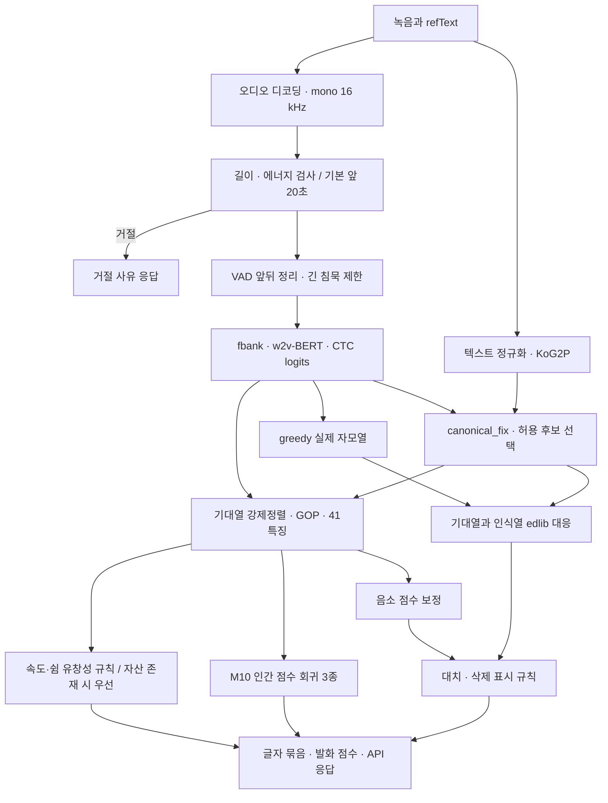
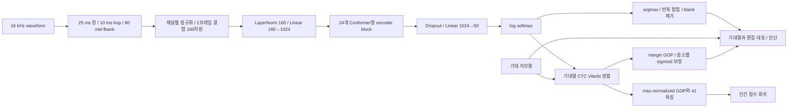
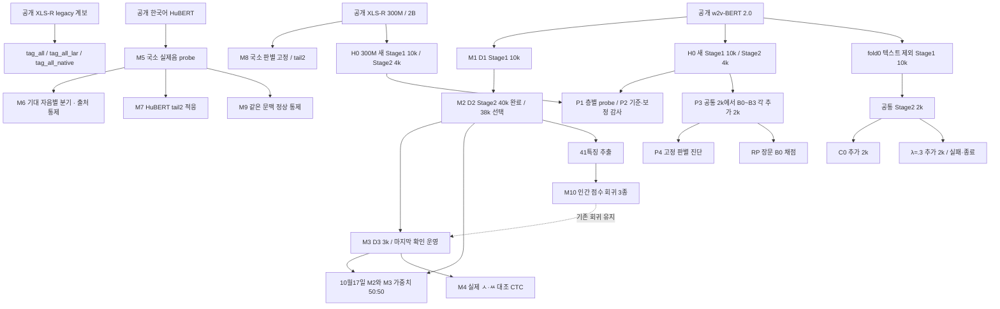

# 한국어 발음평가·MDD 전체 개발 및 CTO 기술검토 보고서

**CTO에게 먼저 전달할 문서:** [사용한 모델·데이터셋·시도한 방법과 결과](인수인계보고서.md). 실제 수행한 작업과 채택 여부를 표로 정리했다. 이 문서는 세부 구현·실험·원시 근거를 확인하기 위한 상세 자료다.

작성일: **2026-10-30 KST**. 대상: 비원어민 한국어 발음 진단·점수 서비스와 관련 연구. 저장소 기준: `main`, commit `a6f50ea66652defa2fdfe04000ee7166e4d32023`. 작업 트리에 이미 있던 10월30일 종료 결정 문서도 함께 읽었으므로 이 보고서 전체를 해당 commit의 내용이라고 부르지 않는다.

이 보고서는 코드·설정·매니페스트 통계·보존 로그·모델 파일·평가 결과를 읽고 작성했다. 모델 파일의 헤더와 SHA-256, 저장 점수 모델의 속성, 기존 결과의 집계를 확인했으며 새 음성 추론·학습·GPU 작업·원격 서비스 변경은 수행하지 않았다. **운영의 마지막 원격 확인은 10월25일이고, 보고서 작성일의 온라인 상태는 확인하지 않았다.** 출처 번호 [E01](#e01)~[E20](#e20)는 J절에서 실제 경로·JSON key·해시로 연결한다. 확인하지 못한 과거 실행 인자를 현재 코드 기본값으로 채우지 않았다.

읽는 순서: [A. Executive Summary](#a-executive-summary) → [I. CTO 판단 사항](#i-cto-판단-사항) → 구현 검토는 C·E·G, 실험 검토는 D·F·H, 재현은 J.

## A. Executive Summary

### A.1 제품 목표와 현재 도달점

목표는 한국어가 모국어가 아닌 학습자가 **임의의 한국어 문장**을 읽었을 때, 입력 문장에 맞춰 실제 발음의 오류 위치와 대치된 소리·삭제·삽입을 진단하고 학습용 점수를 제공하는 것이다. 입력은 녹음과 `refText`다. 음향 모델은 녹음에서 실제 자모열을 추정하고, 별도로 생성한 기대 발음과 비교한다. 따라서 문장을 알아맞히는 ASR 정확도만 높아져서는 충분하지 않다. 실제 오류를 기대 발음으로 복원하면 MDD에서는 미검출이다.

마지막으로 확인한 서비스는 **M3 `w2vbert_synth_tense_v2/step_3000`**의 NPU 실행이다. 음향 모델, G2P·기준 발음 보정, CTC 강제정렬 점수, 표시 규칙, 인간 점수 회귀기가 결합돼 있다. **서비스가 존재한다는 사실과 자유 문장 MDD의 성능 목표를 달성했다는 판단은 별개다.** 실제 고객 문장·기기·오류 분포에서 정상 헛지적 1%와 유용한 정확 진단 재현율을 동시에 입증한 자료는 없다. [E01](#e01), [E02](#e02)

| 구분 | 확인된 상태 | 해석·제한 |
|---|---|---|
| 마지막 확인된 운영 | M3 단독, NPU 7, `canonical_fix`, 삭제 점수 50, ㄴ↔ㄹ 예외 사용 | 2026-10-25 원격 확인. 10월30일 상태·자산 해시는 미확인 |
| 완료한 비운영 연구 | 실제음 대조 CTC, HuBERT/XLS-R 국소 판별, H0 백본 통제, 층별 probe, 중간 CTC·층 결합, RP 채점, 가중 CTC fold0 | 일부 국소 개선은 있으나 사전 전체 성능 기준을 통과한 운영 교체 후보 없음 |
| 종료 | λ=.3 가중 CTC 연구 분기, fold1~4 확장 | fold0 실패 후 사용자 결정으로 종료. 같은 자료에서 가중치 구제 재탐색 중단 |
| 보류·미실행 | 별도 P5 C1/C2 본 학습, 새로운 손실·P7, 대안 구조의 후속 학습 | 본 보고서 작성으로 착수하지 않음 |
| 미확보 | 새로운 독립 문장·화자의 검증된 실제음 자료, 독립 청취·합의 판정 | 기존 9문항·RP 3대본·재분할 fold0를 새 최종 시험으로 사용할 수 없음 |

### A.2 결론을 좌우하는 성능 증거

아래 행들은 **서로 다른 평가**다. 같은 열에 배치했어도 모델 간 직접 차감 대상이 아니다. `정확 진단`은 오류 위치와 실제음까지 맞힌 값이며, `오류 검출 F1`과 구분한다.

| 평가·정책 | 확인한 결과 | 의사결정 의미·근거 |
|---|---|---|
| M2, D2 test 184,074발화, greedy 음소 비교 | 오류 검출 F1 **0.4964**. 정상 FR **40,181/1,777,559**; 오류 검출 **36,622/70,744**, 정확 진단 **31,110/70,744** | 기존 문항·분리 화자 성적. 최종 서비스 표시 성능이 아님. [E04](#e04) |
| M3 운영 설정 재현, ㅅ/ㅆ 중심 CAL 5,425녹음 | 정상 헛지적 **93/7,189=1.294%**; 전체 확정 오류 정확 진단 **20/232=8.62%**. 오류 **58/232** 입력 거절 | 입력 거절·인식·표시 문제가 함께 있음. 실제 고객 무작위 표본 아님. [E07](#e07) |
| H0 백본 통제, CAL에서 1% 문턱 고정, 선택 unseen 9문항 | 4k w2v-BERT: FP **1,673/34,706**, 정확 **157/1,287**. XLS-R: FP **997/34,706**, 정확 **178/1,287** | 보정 후 XLS-R이 이 조건에서는 낫지만 둘 다 1% 실패. 전반적 백본 우월성으로 확대 불가. [E10](#e10) |
| fold0, 동일 CAL 정책, 바깥 38문항·29,821녹음 | C0→λ=.3: 정상 FP **15,426/288,128=5.35% → 13,648/288,476=4.73%**; 전체 오류 정확 **3,484/9,620=36.22% → 3,090/9,620=32.12%** | 정상 보호와 함께 검출도 감소. 두 조건 모두 목표 미달. 운영 M3 성적과 다른 연구 계보. [E16](#e16) |

최근 fold0는 **공통 Stage1 10,000 + 공통 Stage2 2,000 + C0 추가 2,000 + 후보 추가 2,000 = 총 16,000회** 모델 갱신을 완료했다. 각 조건은 동일한 33,657녹음을 평가했다. 내부 선택에서도 정상 FPR **581/7,881→488/7,950**, 정확 진단 **120/373→108/373**이고, 기대 ㄴ 오류 **19/59→15/59**로 사전 보호 기준을 위반했다. 완료 기록과 단계별 종료코드, 공통 부모·배치 순서가 일치한다. **실행 실패가 아니라 사전 성능 기준 미달**이다. [E16](#e16)

### A.3 확인된 진전과 가장 큰 위험

진전은 실제음 TAG를 사용하는 학습·추론 체계를 구축하고, NPU에 배포했으며, 정상 지적을 줄이는 일부 운영 개선과 재현 가능한 통제 실험·부분 주석 평가 체계를 확보했다는 점이다. 그러나 정상 지적 감소가 검출 개선과 항상 동반되지는 않았다. 10월21일 변경에서 실제 삭제 지적은 **217/455→110/455**로 줄었다. 이후 중간 CTC·국소 보조 모델·2B 확대·가중 학습도 서비스 목표를 통과하지 못했다. [E05](#e05), F절

핵심 위험은 다음 다섯 가지다.

1. **문항 일반화:** D2 외국인 고유 학습 녹음은 1,481,511개지만 문항은 226개다. 화자 분리 성적을 새 문장 성적으로 읽을 수 없다. 엄격한 새 지도학습 계보를 만든 fold0에서도 CAL 문턱이 다른 문항으로 이전되지 않았다.
2. **정답의 신뢰도:** TAG가 있는 것과 독립적인 사람 판정 신뢰도를 확인한 것은 다르다. ㅅ/ㅆ 판정 기준·평가자 간 일치도·불일치 조정 자료를 확보하지 못했다. 기준 발음의 허용 변이·주석 관례도 일부 미해결이다.
3. **측정·표시 계약:** F1, 정확 진단, 점수 PCC, 관측 FPR, 전체 오류 분모의 재현율이 혼재했다. API의 `words`는 한글 글자 묶음이고, `0`과 판정 불가가 `null`로 합쳐지는 경로가 있다.
4. **검출과 정상 보호의 상충:** 문턱 완화로 일부 유보는 해제할 수 있지만 기대음을 출력한 오류는 복구되지 않는다. 중간층의 좋은 사례만 선택하면 다른 음소·삭제·삽입에서 발생하는 손실을 놓친다.
5. **운영 검증 범위:** 실제 사용자 분포·모바일 입력·현재 SLO·최신 원격 자산 동일성은 미확인이다. 브라우저 리샘플링의 로컬 수정과 현재 운영 반영을 구분해야 한다.

### A.4 CTO에게 필요한 결정

우선 결정할 것은 ① 자유 문장 진단을 계속 제품 필수 목표로 둘지, ② 검증 가능한 실제음·정상 자료와 사람 판정에 투자할지, ③ 당장 제공할 진단 범위와 유보·거절의 의미를 어디까지 제한할지, ④ 점수와 오류 진단 각각에 어떤 출시 기준을 둘지다. 검증 자료를 확보하지 못한 상태에서는 기존 자료의 개발 비교가 가능하더라도 서비스 일반화의 증명 범위는 늘어나지 않는다.

**본 보고서의 권고는 종료한 가중 CTC를 재개하는 것이 아니다.** I절의 A/B/C 선택지 중 제품 범위·데이터 확보·운영 품질의 우선순위를 먼저 결정하고, 그 선택에 맞는 검증 계획을 승인하는 것이다. 새 자료·사람 참여가 현재 불가능하다는 제약을 인정하며, 이 제약을 자동 라벨이나 기존 평가셋의 이름 변경으로 대체하지 않는다.

## B. 문제 정의와 실제 라벨링 원리

### B.1 세 가지 서로 다른 정답

| 정보 | 의미·생성 | 사용 위치 | 혼동하면 생기는 오류 |
|---|---|---|---|
| `refText` / LAB 기대열 | 읽도록 제시한 텍스트와 원본 기준 발음 주석. 서빙은 KoG2P·`canonical_fix`로 생성 | 기대 위치·강제정렬·GOP·진단 비교 | LAB를 실제 발음 정답으로 학습하면 오류를 정상으로 복원할 수 있음 |
| TAG 실제열 | 녹음에서 실제로 발음됐다고 주석된 자모열·시간 | D2 CTC 감독, 연구 평가의 실제음 정답 | TAG의 편집 정렬 모호성과 사람 판정 불일치를 같은 것으로 취급하면 안 됨 |
| 인간 1~5 점수 | 발음 숙달도·이해가능성·유창성에 대한 평가 | M10의 세 회귀 목표 | 한 음소의 실제음 정답도, 오류 검출 F1도 아님 |

D2의 기본 CTC 타깃은 **실제 TAG 자모열**이다. D1은 원어민 전사문을 KoG2P로 변환한 타깃이며, 음소마다 사람이 청취해 붙인 TAG와 다르다. D3은 합성기에 의도한 정상/오류 전사를 준 뒤 만든 타깃이다. 합성 결과가 의도한 대립을 실제로 구현했는지는 별도 문제이며 모델 기반 필터를 통과했다는 사실이 독립 청취를 대신하지 않는다. [E03](#e03), [E06](#e06)

### B.2 기대열과 실제열에서 평가 단위를 만드는 방법

완전 주석에서는 LAB↔TAG의 전역 최소 편집 대응으로 기대 자리에 실제 자모 또는 삭제를 연결한다. 실제음이 같으면 정상, 다르면 대치, 대응 실제음이 없으면 삭제다. 기대 자리 사이에서 남은 TAG 음소열은 삽입 gap의 정답이다. 여러 최소 경로가 다른 실제음을 연결하면 그 자리는 모호하다. 같은 음소가 반복되는 문장에서 한 경로를 임의 선택한 값과 모든 최적 경로에서 확정되는 값은 다를 수 있다.

원본 `spn`·해석 불가 문자열은 불명이다. **TAG의 단독 `-`는 명시적 삭제**이며 불명과 다르다. `ㄹ-`처럼 혼합된 표기는 임의로 정상 자모만 추출하지 않는다. 예전 학습 매니페스트는 불명 조각을 버리고 남은 자모로 LTR을 만들었으므로 `dropped`가 있는 녹음도 학습에 포함됐다. 따라서 D6·D7을 기반 모델 미노출 자료로 소개한 과거 설명은 잘못됐다. [E07](#e07)

후기 RP·fold0 평가는 불명을 길이 0 이상 음소열의 wildcard로 남긴다. 모든 최적 대응에서 실제음이 하나로 결정되는 자리만 정상/대치/삭제 분모로 확정하고, 미확정 실제음은 별도 보존한다. 모델의 위치 대응·GOP가 실패해도 **이미 확정한 정상·오류 분모는 줄이지 않고** 관측 불가로 남긴다. 시간 마스크는 채점 제한에 쓰며 입력 녹음 선정에는 쓰지 않는다. 이 방법도 원본 라벨의 지각적 진실을 복원하는 것은 아니다. [E14](#e14), [E16](#e16)

### B.3 설명용 가상 사례

다음 네 예시는 기록에서 가져온 사용자 녹음이 아닌 설명용 자모열이다. 삭제는 `∅`, 삽입은 gap 안의 열로 표시한다.

| 종류 | 기대열 | 실제 TAG | 올바른 진단 | 잘못된 시스템 반응 |
|---|---|---|---|---|
| 정상 | `ㅅㅏ` | `ㅅㅏ` | 오류 없음 | `ㅆㅏ`로 인식해 ㅅ→ㅆ 경고하면 정상 헛지적 |
| 대치 | `ㅅㅏ` | `ㅆㅏ` | 첫 자리 ㅅ→ㅆ | `ㅅㅏ`는 기대음 복원·미검출; `ㅈㅏ` 경고는 오류 탐지지만 실제음 오진 |
| 삭제 | `ㄱㅏㄴ` | `ㄱㅏ` | 마지막 ㄴ→∅ | ㄴ을 인식·복원하거나 유보하면 삭제 미검출 |
| 삽입 | `ㅅㅏ` | `ㅅㅡㅏ` | 두 기준 자리 사이 gap에 `ㅡ` 삽입 | 기준 자리의 대치로 밀어 넣거나 `ㅜ` 삽입이라 하면 정확 삽입 진단 실패 |

실제 감사의 `수리→소리`는 별도의 **기존 TAG 정상 발화에서 관측한 모델 출력 혼동**이다. 해당 녹음을 이번 보고서 작성에서 청취해 실제 ㅜ/ㅗ를 판정한 것은 아니다. [E11](#e11)

### B.4 지표 계약

| 용어 | 이 보고서의 정의 |
|---|---|
| 오류 검출 | 실제 오류 자리에 오류 경고가 있음. 지적한 실제음이 맞는지는 별도 |
| 정확 진단 | 오류 위치와 실제음이 모두 정답과 일치. 삽입은 gap의 음소열 전체 일치 |
| 실제음 오진 | 오류는 경고했지만 실제음이 TAG와 다름 |
| 기대음 복원 | 실제 오류인데 인식기가 기대음을 출력함 |
| 정상 FPR | 정상 자리 중 잘못 지적한 비율. 전체 확정 정상인지 관측 정상인지 표마다 명시 |
| 발화 헛지적률 | 발화 중 정상 자리를 하나 이상 지적한 발화의 비율. 자리 FPR과 다름 |
| Coverage | 추론 전 확정한 정상/오류 중 채점 가능한 비율. 두 분모를 따로 계산 |
| 미관측·입력 거절 | 정답이 정상이라는 의미가 아님. 전체 오류 재현율에서 성공으로 계산하지 않음 |
| 조건부 95% 구간 | 고정 모델·정책의 화자 또는 문항 재표집 구간. 학습 seed·CAL 선택·반복 탐색 불확실성까지 포함하지 않음 |

`Recall @ FPR≤1%`라는 이름은 평가에서 실제 FPR 조건을 만족할 때만 쓴다. CAL의 정상 1% 예산으로 문턱을 정했다는 이유만으로 새 문항에서 같은 성능을 달성한 것이 아니다. 오류 균형 표집의 정밀도를 실제 고객 정밀도로 바꿀 수도 없다.

## C. 전체 시스템 아키텍처

### C.1 제품 호출 흐름



근거: [`app.py`](../deploy/pronunciation-demo/app.py)의 `decode_audio`, `check_audio`, `analyze`, `align`, `sent_eval` 경로와 [`speechsuper.py`](../tasks/pronunciation-assessment/src/mdd/speechsuper.py)의 `build`. 그림의 단계는 데이터 의존관계다. 실제 `analyze`는 VAD→canonical 생성→한 번의 forward→같은 log-probability로 기준 후보 선택→특징 계산→인식 대응→회귀 점수 순으로 실행한다. 서비스에는 TAG가 입력되지 않는다. [E02](#e02)

### C.2 음향 모델 내부와 두 점수 경로



M3 저장 설정과 실제 HF 4.46.3 구현을 확인했다. 이름은 `Wav2Vec2BertForCTC`지만 raw waveform을 convolution feature extractor에 바로 넣는 일반 wav2vec2 설명으로 대체하면 안 된다. `SeamlessM4TFeatureExtractor`가 80차원 filterbank를 만들고 인접 프레임 둘을 묶는다. 블록은 **절반 계수 FFN→상대 위치 attention→depthwise convolution→절반 계수 FFN→정규화**를 포함한다. 단순 Transformer FFN·attention 두 항만의 구조가 아니다. [E02](#e02), [E03](#e03)

| 단계 | 실제 값·shape | 학습/추론 구분 |
|---|---|---|
| 파형 | 16,000 samples/s, mono, 길이 N | 디코딩·리샘플링 규칙 |
| fbank | 400 samples 창, 160 hop, pre-emphasis .97, 80 mel | 학습 파라미터 없음 |
| 정규화·stack | 채널별 평균/분산, stride 2 → `[B,T,160]` | 약 20 ms 간격. 끝 프레임 처리 포함 |
| feature projection | LayerNorm(160), Linear(160,1024) → `[B,T,1024]` | 음향 모델 파라미터 |
| encoder | 24층, hidden 1,024, attention 16 heads, FFN 4,096, convolution kernel 31 | 전체 적응 또는 실험별 고정 |
| 위치 처리 | relative-key, 왼쪽 64·오른쪽 8 설정 | 단순 절대 위치 embedding 설명과 다름 |
| 출력층 | `[50,1024]` weight + `[50]` bias → `[B,T,50]` | CTC linear projection |
| 사전 | 자모 46개는 ID 4~49. CTC blank=0, unknown fallback=3; HF config bos=1/eos=2/pad=0 | ID 1~3은 실제 자모가 아님. fairseq 특수 토큰 명칭과 HF pad/blank를 혼동하지 않음 |
| 파라미터 | M1/M2/M3 저장 tensor 775개, 원소 **580,544,370개** | 전체 적응 시 약 580.5M; 서빙 optimizer 갱신 0 |
| 규제 | SpecAugment `apply_spec_augment=false`; LayerDrop .1, activation/conv/final dropout .1, hidden/attention dropout 0 | config의 mask probability .5가 있어도 증강이 켜진 것은 아님. eval 모드에서는 dropout 비활성 |
| NPU 입력 | `[1,T,160]`와 valid mask `[1,T]`, T=192/448/1024 | 가변 길이를 고정 버킷에 padding |

원래 10 ms fbank와 20 ms 모델 프레임을 구분해야 한다. RP 연결 실행에서 사용한 프레임 중심은 원음 기준 `280+320·i` samples이고, 중심을 무조건 0으로 시작하지 않는다. CTC 피크는 음소의 전체 마찰·모음 지속구간 정답이 아니다. TAG 시간과 다르다는 이유만으로 정렬 오류라고 판정하지 않는다.

**자동회귀 Transformer decoder는 현재 경로에 없다.** `HFDecoder`·`RBLNDecoder`라는 클래스는 모델 실행을 감싸는 인터페이스다. 실제 decoding은 프레임 argmax→연속 동일 ID 합침→blank 제거이며 beam search·외부 언어모델을 쓰지 않는다. 반복은 blank 제거 전에 합친다. 기대열은 인코더 입력이 아니지만, 허용 기준 후보 선택과 강제정렬에는 사용된다.

### C.3 GOP·보정·표시

`gop_feats_v2.utt_features`는 기대열을 CTC Viterbi 정렬하고, 기대 토큰 c에 연결된 프레임 집합 S에서 다음을 계산한다.

```text
margin(c) = mean[t∈S] { log P(c|t) − max[k≠c] log P(k|t) }
p_error = sigmoid(a_group × margin + b_group)
phone_score = round(100 × (1 − p_error))
```

경쟁 토큰에는 코드상 blank·특수 토큰도 포함된다. `초성 ㅅ`, `초성 ㅆ`, `받침 …`, `모음 …` 단위의 a/b를 사용하고 없으면 `_global`로 돌아간다. 로컬 `score_phoneme/calibration.json`의 `_global`은 a=−0.56669938, b=−1.31615033, n=1,787,938, 표기된 오류율 .03802257이다. **이는 보정 파일 메타데이터이며 현재 서비스 사용자 수나 새 독립 검증 수가 아니다.** 원격 보정 파일과의 최신 동일성은 미확인이다. [E02](#e02), [E17](#e17)

| 표시·결측 처리 | 실제 코드 동작 | 서비스 의미 |
|---|---|---|
| 일반 대치 | 인식음≠기대음이고 점수<60이면 표시; 60 이상이면 `uncertain:true` | 높은 점수는 오류가 없다는 독립 확인이 아님 |
| 세기 예외 | 초성 예사→된/거센소리, greedy token probability≥.6 | ㅅ→ㅆ도 기존 예외에 포함 |
| ㄴ↔ㄹ | 초성·종성, 확률≥.6, 마지막 확인된 운영에서 켬 | 점수 60 이상의 지적도 가능 |
| `--ss-rule` | ㅅ→ㅆ 기준 .5, ㅆ→ㅅ은 .6 및 문두/앞 기대음 모음 조건 | 운영에서는 꺼짐. 기대음을 낸 자리의 새 실제음을 찾는 모델은 아님 |
| 삭제 | 기본 강제정렬 점수<50, 연속 삭제 최소 1. 글자 통째 누락은 해당 묶음 점수 평균 등 별도 경로 | 결측·전체 글자 누락 처리가 있으므로 단일 조건으로 요약하면 불완전 |
| 인식 확률 | 그 토큰을 argmax로 낸 연속 프레임 중 최대 확률 | 발음 정확성의 보정 확률과 다름 |
| GOP 정렬 실패 | 특징 코드에는 −10.0 sentinel 경로가 있음 | 모든 정렬 결측이 `None`으로 끝나는 것은 아님. 후기 연구의 관측 마스크와 다름 |
| 삽입 | 운영 `align`은 canonical이 `-`인 삽입 열을 건너뜀 | formatter의 삽입 표현 기능만 보고 전체 삽입 진단이 운영된다고 할 수 없음 |
| null | 삭제의 실제음·음소 점수는 null 가능; 마지막 출력에서 숫자 0도 null로 변환 | 0점과 판정 불가가 같은 표현. 평균에는 0을 포함한 뒤 변환 |

### C.4 인간 점수 회귀와 화면 점수는 별도 경로다

M10은 `HistGradientBoostingRegressor` 세 개다. 41개 특징으로 발음·이해가능성·유창성 1~5 인간 점수를 각각 예측하며 범위를 1~5로 제한한다. 핵심 특징은 발화 길이·속도, CTC blank 비율, 기대열 NLL, 편집 오류 비율, 오류 종류, GOP 분포, 강제정렬 토큰 사이의 pause와 발화 앞뒤 간격이다. **회귀기의 GOP는 margin이 아니라 `logP(expected)−max_k logP(k)` 계열 요약**이다. margin은 음소 점수 보정에 별도로 전달된다. [E17](#e17)

`speechsuper.build`의 화면 `pronunciation`은 **M10 발음 예측을 직접 표시하는 값이 아니라 유효 음소 점수→한글 글자 묶음→발화 평균**이다. M10 발음 예측은 raw human metadata에 남는다. 유창성은 인간 점수 변환으로 초기화하지만 **`fluency_rule.json`과 특징이 있으면 속도·쉼 규칙 값이 우선**한다. 현재 로컬 기본 경로에는 이 파일이 존재한다. 이해가능성의 발화 표시 여부는 옵션에 따라 달라진다. `rhythm` 필드도 독립 운율 측정이 아니라 이해가능성 값을 담는 경로가 있다. `overall` 가중치는 발음 .6·유창성 .2·이해 .2이며 실제 있는 항목으로 재정규화한다.

1~5→0~100은 백분위 자산이 있으면 학습자 점수 분위수에서 보간하고, 없으면 `v/5×100`이다. **1점을 0점으로 만드는 `(v−1)/4` 변환이 아니다.** 백분위 점수는 해당 기준 집단 내 상대 위치이고 물리적 정확도 백분율이 아니다. API `words`는 철자 한글 글자별 묶음이며 언어학적 어절 또는 단어 경계가 아니다. 세션 코드는 실제 상수 기준 유효 발화 최소 10개, 권장 30개, 음소 위치별 최소 20개를 사용한다. 회귀 평가의 화자당 최소 3발화와 다르다.

### C.5 모듈별 감독 경계

| 모듈 | 갱신하는 것 | 학습 때의 라벨 | 서빙 입력 |
|---|---|---|---|
| M1 encoder+CTC | 초기 고정 이후 전체 | D1 전사→KoG2P | 녹음만 |
| M2/M3 encoder+CTC | 전체 미세조정 | M2 TAG, M3 합성 의도+실제 replay | 녹음만 |
| G2P·canonical_fix | 규칙·사전 및 후보 선택 | 일반 optimizer 학습 아님 | refText, 허용 후보 선택에 모델 log-probability |
| GOP·편집 대응 | 알고리즘 | 연구 평가에서는 LAB/TAG로 정답 비교 | 기대열·모델 출력. 실제 TAG 없음 |
| 음소 보정 a/b | 별도 보정 계수 | 정상/오류 라벨 | margin·음소·위치 |
| M10 | 트리 기반 회귀기 | 인간 1~5 점수 | 41특징 |
| P1 TAG window | 연구용 probe | 실제 TAG 시간 | 운영에서 사용 불가 |
| fold0 평가 마스크 | 평가 규칙 | LAB/TAG 불명·시간·대응 | 서비스 입력 규칙으로 배포한 것이 아님 |

## D. 데이터셋 인벤토리

### D.1 수량·역할 총괄

행·녹음·자리·draw는 다른 단위다. 아래 `시간 미집계`는 자료가 없다는 뜻이 아니라 이번에 확인한 결과에 해당 전체 시간 집계가 없다는 뜻이다. 라이선스는 공개 데이터 출처와 로컬 사용 이력을 확인했으나 개별 다운로드 계약·외부 재배포·상용 허용 범위까지 재검토하지 않았다. 표의 모델 노출은 별도 draw 로그가 없는 경우 **보존 매니페스트 포함**을 의미한다. [E03](#e03), [E06](#e06)~[E17](#e17)

| ID·용도 | 고유/반복 규모 | 시간 | 화자·문항/텍스트 | 라벨·노출·평가 역할 |
|---|---|---|---|---|
| D1 Kspon 원어민 적응 | train 531,162행, dev 2,149행 | 691.19 / 2.75h | 고유 텍스트 496,273 / 2,101; 화자 전수 수 미확인 | 전사→KoG2P. M1, H0 Stage1; H0/fold에서는 텍스트 제외 여부 다름 |
| D2 AIHub 040~043 | 외국인 고유 train 1,481,511; 실제 반복 포함 전체 train 2,000,319행 | train 반복 포함 1,953.6h | train 9,656화자·226문항 | 실제 TAG+원어민 replay. M2 주 학습 |
| D2 valid/test | 10,000 / 184,074발화 | 9.15 / 168.11h | 1,218 / 1,195화자, 각 225문항 | 화자 분리, 문항은 train에 있음 |
| D3 합성 대조 | train 5,452쌍=10,904고유 합성녹음; 합성 반복 21,808+실제 replay 150,000행 | 고유 합성 8.89h | 합성 105목소리; dev 286쌍 별도 | 합성 의도 라벨. M3의 171,808행 |
| D4 실제 ㅅ/ㅆ 대조 | train 768, CAL 512, 첫 평가 512, 후속 493발화 | 미집계 | 연구 역할 분리; 기반 M3 문항 미노출은 아님 | M4. 오류·정상 균형 선정 |
| D5 국소 TRAIN | 7,536녹음·14,002자리 | 미집계 | 4,419화자·38문항 | M5~M9. 모두 M2 train, M3 train 969녹음 포함 |
| D6 부분 전사 복원 | 694녹음·원천 1,750자리 | 미집계 | 564화자·31문항 | 가용 새 쌍 오류 675. 모두 M2 train, M3 97녹음 |
| D7 문맥 정상 | 1,248녹음·원천 3,227자리 | 미집계 | 1,124화자·27문항 | 가용 확정 정상 2,851. 모두 M2 train, M3 166녹음 |
| D8 CAL | 5,425녹음·8,894자리 | 미집계 | 401화자·28문항 | 정상 8,652·오류 232·모호 10. D2 test 재사용 |
| D8 primary | 943녹음·1,329자리 | 미집계 | 495화자·22문항 | 정상 977·오류 337·모호 15. D2 test 재사용 |
| D8 보호 후보 | 488녹음 | 미집계 | 360화자·22문항 | 483개 M2 valid, 5개 test. 시스템 전체 독립 최종셋 아님 |
| H0 train | 1,761,083반복 행 | 4k 실제 draw 약432.17h/백본 | 외국인 9,647화자·202문항 | 문항분리 CTC 통제. 별도 Stage1 텍스트 노출 제한 존재 |
| H0 선택 seen/unseen | 5,241 / 4,009녹음 | 미집계 | 629 / 652화자·201 / 9문항 | CAL과 화자 분리. 반복 분석 개발 자료 |
| RP 전체/선정 | 11,317 / 1,118녹음 | 151.46 / 약14.80h | 8,613 / 859화자·각 3대본 | 부분 주석 장문. 기존 평가 화자의 다른 녹음 포함 |
| P6 재분할 | 193문항의 5개 fold | fold별 실제량 별도 | 63문장·130낱말 | 설계·검증 완료. fold0만 학습·평가 |
| fold0 Stage1/2 | 446,148 train·1,810 dev / 1,075,572 Stage2행 | 실제 draw는 E·F절 | Stage2 외국인 9,530화자·116문항 | 공개 SSL부터 재출발. 내부·바깥 텍스트 제외 |
| M10 특징 자료 | train 200,000 / test 178,049행 | 녹음 총시간 미집계 | 9,436 / 1,196화자 | 41특징과 1~5 점수. 목표별 유효 행·평가 화자는 D.8 참조 |

### D.2 D1: 원어민 타깃의 의미

`manifest_kspon_native_v1/stats.json`에서 train 22,502,611타깃 토큰·38종 자모, dev 89,131토큰·38종을 확인했다. train 중앙 길이는 3.755초다. 불명 표기·길이·비한글·손상 형식 등을 제외한 자산이다. 통계의 train 제외 항목은 unclear-star 53,231, duration 21,413, non-Hangul 6,179, `u` 7,930, corrupt slash 85다. 이 수를 서로 배타적인 전체 원천 분해라고 재정의하지 않는다.

원어민 감독은 한국어 음향 적응에 유용하지만, 철자 전사→G2P와 실제 음소 청취 전사는 동일하지 않다. H0에서는 외국인 홀드아웃 문장이 Stage1 전사에 포함될 수 있었다. fold0에서는 내부 선택·바깥 평가와 정규화 전체 문자열 또는 12글자 부분열이 겹치는 Stage1 train/dev·replay를 제외했다. 공개 SSL 사전학습까지 미노출임을 보증한 것은 아니다. [E03](#e03), [E10](#e10), [E16](#e16)

### D.3 D2: 많은 발화와 적은 문항

원래 외국인 고유 train 풀은 정상 1,080,172 + 오류 401,339 = 1,481,511발화다. 오류에 318,776행을 추가 재표집해 720,115행으로 만들고 native 200,032행을 더해 2,000,319행을 구성했다. 행 비율은 native .10·외국인 정상 .54·오류 .36이고, 오디오 시간 비율은 .1380/.4714/.3906이다. **행 균형은 시간·음소·문맥·gradient 균형이 아니다.** [E03](#e03)

valid/test 오류 발화는 2,758/49,644개다. valid는 99,342토큰·42자모, test는 1,843,618토큰·44자모를 가진다. 통계에서 화자 교집합은 0이며 valid/test의 문항은 train에 포함된다. 필터에는 .5~15초 길이, 8 kHz 제외, 빈 전사·음소 tier 부재·OOV가 있다. `test_unseen`이라는 다른 매니페스트 이름만 보고 문항 미노출을 주장할 수 없다. [E03](#e03), [E04](#e04)

원본은 영어권 및 중·일어권 등 비원어민 한국어 자료다. 전체 D2의 목표 서비스 대비 L1·숙달도·마이크 대표성을 확인한 것은 아니다. D5/CAL/primary에서는 아래와 같이 숙달도 구성이 다르며 단위는 **녹음 수**다.

| 분할 | Beginner | Intermediate | Advance | Fluent |
|---|---:|---:|---:|---:|
| D5 | 4,051 | 2,024 | 1,293 | 168 |
| CAL | 3,009 | 1,474 | 767 | 175 |
| primary | 569 | 231 | 121 | 22 |
| D6 | 373 | 159 | 152 | 10 |
| D7 | 534 | 368 | 294 | 52 |

CAL 상위 L1은 영어 882·인도네시아어 648·일본어 531·베트남어 516·중국어 477녹음이다. 전체 분포와 방향별 성능은 [모국어 TSV](../tasks/pronunciation-assessment/results/발음평가_진단감사_2026-10-26_모국어별.tsv)에 있다. 해당 TSV의 기준은 연구 `label_existing`이며 순수 운영 재현 지표와 합치지 않는다. [E07](#e07)

### D.4 D3·D4: 합성 대립과 실제 대립

D3의 5,452쌍은 Chatterbox 2,671·Qwen3-TTS 2,781쌍이다. 텍스트 출처는 Kspon 3,727·Kspon boost 1,316·기존 prompt 409쌍이다. ㅅ→ㅆ 349·ㅆ→ㅅ 73쌍으로 방향 수도 다르다. 777쌍은 WAV 부재 4·길이 2·contrast 647·check CER 124 사유로 제거됐다. 실제 replay 150,000행 안에는 native 14,874행도 있다. 세기 대립 실제 오류 22,623행의 가중치 1.5를 준비한 통계는 있으나 M3 당시 정확한 `--weights` CLI가 확보되지 않아 실제 가중 적용을 확정하지 않는다. [E06](#e06)

D4 train 768발화는 오류 256·같은 문항 정상 256·다른 정상 256의 구성이다. 첫 평가의 두 방향 오류는 각 64자리, 정상은 317/239자리다. CAL의 두 방향 오류는 6/1개로 매우 적다. 별도 CAL·평가 화자 분리만으로 부모 M3까지 포함한 문항 독립성을 만들지는 못한다. 합성 의도 라벨과 실제 TAG를 같은 신뢰도로 합산하지 않고, 실제음 대조 손실의 효과는 일반 CTC 대조군과 비교했다. [E08](#e08)

### D.5 D5~D8: 국소 보조 실험과 기반 노출 감사

D5 원천 14,002자리는 정상 9,321·쌍 오류 3,821·삭제 108·제3음 558·모호 194다. 관측 입력 13,741개와 감독 가능한 12,762개는 다른 수다. 감독 클래스 수는 7,760/4,500/300/169/33이며, 입력이 있어도 라벨을 못 붙인 979개와 입력 없는 261개를 유지한다. 초기 300회 minibatch 학습의 실제 draw는 4,724개, 고유 입력은 2,203개였다. 전수 입력을 모두 매회 학습했다고 볼 수 없다. [E09](#e09)

D6는 원천 1,750자리 외 추가 query 72개가 있어 레코드 수 1,822와 원천 자리 수가 다르다. 가용 쌍 오류 675개(297/378), 정상 876개(620/256)는 **오류가 포함된 694녹음 안의 정상**이다. 새 독립 정상 녹음 집단이 아니다. D7 원천 3,227자리는 확정 정상 3,107·불명 120이고, 관측·감독 조건까지 통과한 정상은 2,851개(1,682/1,169)다. M9는 이 풀 전체를 정상 학습으로 쓰지 않고 방향별 고유 정상 297/256개로 반복량을 맞췄다.

M2 실제 LTR 대조에서 D6 694개·D7 1,248개 모두 불명 조각을 제거한 `legacy_actual`과 일치했다. 과거 “부분 전사라 M2에서 제외” 설명을 정정한다. 원래 D5/D6/D7의 M2 train 포함 수는 각각 7,536/694/1,248, M3 train 포함은 969/97/166이다. 이 결과는 실제 optimizer의 발화별 반복 횟수까지 증명하지 않는다. [E07](#e07)

CAL 232오류는 쌍 오류 175와 제3음·삭제 57, primary 337오류는 쌍 245·제3음 85·삭제 7이다. 전체 오류율은 CAL 232/8,894=2.61%, D5 4,487/14,002=32.05%, primary 337/1,329=25.36%로 표집 자체가 다르다. 정상 FPR뿐 아니라 정밀도·전체 검출률을 비교할 때도 이 구성 차이가 중요하다. 보호 488녹음은 최근 보조 학습·보정·채점에서 보류했다는 의미만 유효하며 483개가 M2 선택용 valid에 있었다.

### D.6 H0·RP의 미노출 범위

H0 train은 외국인 정상 950,985·오류 633,990·native 176,108행이다. 외국인 학습 202문항과 홀드아웃 24문항을 나눴지만 Stage1 원어민 전사에는 홀드아웃 전체 일치 6개·부분 문자열 포함 14개, replay에는 전체 일치 3개·부분 포함 14개가 있었다. 원어민 문자열도 겹치지 않는 엄격 valid/test는 각각 5문항뿐이다. 선택 unseen 9문항에는 기대 정상 표본이 없는 자모 16개가 있다. 새로운 L1은 0개다. [E10](#e10)

RP002/003/004 전체는 각각 4,978/3,156/3,183녹음이며 11,316개가 20초보다 길다. LAB 또는 TAG 불명 보유는 5,629녹음이다. 학습·valid 화자와 겹치지 않는 기존 test hash 후보 1,118개 중 1,117개는 과거 연구에서 평가한 858화자의 다른 장문 녹음이다. 동일 UID 누출과 기존 평가 화자 재사용을 구분한다. 세 대본을 23개 부분 문장이나 4,988입력으로 잘라도 독립 문항 수가 늘지는 않는다. [E14](#e14)

후기 채점의 고정 정상 327,822·오류 4,116은 주석열 대응에서 확정한 부분이다. 별도 실제음 미확정 3,395자리, 음소 개수를 모르는 LAB 불명 556구간을 정상/오류로 채우지 않는다. 정확한 전체 PCM 복제 부재는 확인했지만 부분 복사·다른 리샘플링·미등록 별칭까지 전수 배제한 것은 아니다.

### D.7 P6·fold0의 재분할

문항 문자열·포함 관계·12글자 연속 부분열로 연결된 기존 진단 문항 32개를 제외하고 나머지 193문항을 5개 fold로 구성했다. 각 fold에서 train/CAL/내부 선택/바깥 평가의 화자 역할을 분리하고, 내부·바깥 문항을 Stage1 train/dev 및 native replay에서도 제거한다. **기존 H0 체크포인트는 바깥 문항을 이미 포함하므로 재사용하지 않고 공개 SSL에서 재시작했다.** [E15](#e15), [E16](#e16)

| fold | Stage2 train 문항 | 내부 선택 문항 | 바깥 문항(RS 문장) | 바깥 녹음 | Stage1 train 제외/531,162 | 실행 상태 |
|---|---:|---:|---:|---:|---:|---|
| 0 | 116 | 39 | 38(14) | 29,821 | 85,014 | C0·λ=.3 완료, 실패 |
| 1 | 115 | 39 | 39(12) | 32,026 | 71,800 | 설계만, 실행하지 않음 |
| 2 | 115 | 39 | 39(13) | 32,627 | 72,693 | 설계만, 실행하지 않음 |
| 3 | 116 | 38 | 39(12) | 32,160 | 78,222 | 설계만, 실행하지 않음 |
| 4 | 117 | 38 | 38(12) | 31,031 | 62,014 | 설계만, 실행하지 않음 |

fold0 Stage2는 외국인 정상 553,400·오류 375,771·native 146,401행이다. CAL 2,820녹음/564화자/116문항, 내부 1,016/504/39, 바깥 29,821/1,161/38이다. 주석열 정상/오류는 각각 26,682/960, 8,639/373, 313,505/9,620이다. 원본 LAB 대표 11,759파일의 UserID 대조에서 역할 교집합 0, 필요한 고유 음성 834,243파일 검사에서 역할 간 동일 전체 PCM 복제 0이었다. 서로 다른 UserID의 동일인·공개 SSL 노출까지 배제한 것은 아니다. 기존 자료를 재분할한 개발 추정이며, 외부 독립 최종 평가가 아니다.

### D.8 M10 인간 점수 자료

로컬 JSONL을 CPU로 세고 저장 joblib의 학습·평가 메타데이터와 대조했다. 인간 점수가 0 이하이면 해당 목표의 결측으로 제외하며, 없는 점수를 0점으로 학습하지 않는다. 화자 분리 기준은 녹음 식별자에서 추출한 화자 키이고 학습 코드에 교집합 검사가 있다. 여기의 9,436/1,196화자와 D2 특정 매니페스트의 9,656/1,195를 같은 목록이라고 가정하지 않는다. [E17](#e17)

| 회귀 목표 | 유효 train 행/화자 | 유효 test 행/화자 | 화자당 ≥3 유효 발화 평가 화자 | 발화 PCC / 화자 평균 PCC |
|---|---:|---:|---:|---:|
| 발음 | 199,929 / 9,433 | 177,969 / 1,196 | 1,180 | .4334 / .6707 |
| 이해가능성 | 199,929 / 9,433 | 177,969 / 1,196 | 1,180 | .4326 / .6868 |
| 유창성 | 47,084 / 8,193 | 42,044 / 1,038 | 1,031 | .6104 / .7620 |

화자 평균 PCC는 여러 발화 평균에 대한 상관이며 한 발화 점수의 정확도나 개별 오류 검출률이 아니다. M3 전용 특징으로 이 회귀기를 다시 학습한 기록은 없다. 기존 회귀기를 유지한 교체 영향 검사는 있었고 F.2에서 별도로 설명한다.

## E. 모델별 계보·구조·학습 사양

### E.1 계보



실선은 가중치 또는 특징의 계보이고 마지막 점선은 서비스 결합이다. M5~M9는 M3의 전체 CTC 후속 버전이 아니며, H0·P3·fold0는 M3 배포 모델을 대체하지 않았다. P5/P6의 수치 가중치 계산은 별도 TRAIN 설계이며 그림의 새 음향 모델 노드로 세지 않는다.

### E.2 M0~M3: 운영 계보

| 모델 | 부모·타깃·갱신 | 실제 실행·선택 | 저장·운영 상태 |
|---|---|---|---|
| M0 legacy XLS-R | 공개 XLS-R 300M 계열→한국어/실제 TAG CTC, `tag_all`, `tag_all_lar`, `tag_all_native`는 서로 다른 자산 | task README의 `tag_all` 50k→LAR 추가 15k 기록. 원 실행 전체 CLI·optimizer 상태를 이번에 독립 복구하지 못함 | 보존 성적·가중치 계보 참고. 최신 M3와 동일 평가로 비교해야 함. [E04](#e04) |
| M1 | 공개 `facebook/w2v-bert-2.0`→D1; 새 CTC head 및 encoder | Stage1 **10,000회 완료**, 처음 2,000회 encoder 고정, LR 3e-5. 마지막 valid UER 6.421% | `<C>/w2vbert_stage1/step_10000`. 원어민 적응 부모. [E03](#e03) |
| M2 | M1→D2 실제 TAG+native replay; 전체 CTC | **40,000회까지 로그 존재**, 최대 LR 1e-5, 고정 없음. valid 선택은 **38,000회** | `<C>/w2vbert_stage2/step_38000`. 40k 미완료로 적으면 오류. [E03](#e03), [E04](#e04) |
| M3 | M2→D3 합성+실제 replay; 같은 580,544,370파라미터 | **3,000회 완료**, 로그 LR peak 5e-6, 최종 2.5e-7. best.json은 2k valid UER .04933899; 3k 로그 UER 5.009% | `<C>/w2vbert_synth_tense_v2/step_3000`. 검증 최소 UER 체크포인트와 운영 선택이 다름. [E06](#e06) |
| M2/M3 평균 | 두 checkpoint의 파라미터 50:50 평균 | 두 모델을 요청마다 각각 실행한 ensemble이 아님 | 10월17일 운영 이력. 10월21일 M3 단독으로 변경. [E01](#e01), [E05](#e05) |

M1의 실제 실행 스크립트는 audio samples 1,600,000/microbatch·gradient accumulation 4, valid 2,149개를 지정한다. M2 실행기는 같은 훈련 루프에서 Stage1 부모·40k·LR 1e-5·freeze 0·save 2k·valid 10,000을 지정한다. 루프는 길이별 배치, 한 배치 최대 64발화, AdamW β=(.9,.98), eps=1e-8, WD=0, clip=5, AMP, 기본 seed=42를 사용한다. 스케줄은 초기 .01배에서 총 스케줄의 10% warm-up·40% hold·50% exponential decay, 최종 .05배다. 명시 CLI가 없는 값은 **실행기+해당 루프 구현 근거**이며 과거 실행 snapshot이 없는 항목까지 독립 증명한 것은 아니다.

M2 `final_selection.json`은 valid의 normal false alarm, JER, −preservation, reversion 순으로 4자리 반올림 후 비교하고 동률이면 이른 step을 선택한다. 선택된 38k의 값은 .023/.0492/.4375/.4814이며 valid MDD F1 .5039다. 이 값은 D2 test F1 .4964와 다른 분할이다. 40k 로그 마지막 UER 4.932%만으로 운영 checkpoint가 40k라고 바꾸지 않는다.

M3 당시 정확한 전체 CLI, seed override, 가중치 파일 전달 여부, 발화별 실제 draw 로그는 미확인이다. 가중 CTC 구현은 `Σ_i w_i·(NLL_i/len_i) / Σ_i w_i`다. 가중 파일의 존재나 stats의 pair bonus만으로 실제 실행이 그 경로였다고 단정하지 않는다. **후기 fold0의 손실은 분모가 다르며 E.6에서 별도 명시한다.**

### E.3 M4: 실제음 대조 CTC

M4는 국소 probe가 아니라 M3 전체 CTC를 미세조정한다. D4의 같은 초기값·자료·배치로 일반 CTC control과 대조 손실 rank를 비교했다. 추가 손실은 실제열 y와 반대음소 후보 y′에 대해 `max(0, 2 + NLL(y) − NLL(y′)) / target_length` 형태다. 후보 NLL에는 기대음으로 고친 반사실적 열이 들어가므로 단순 정상 텍스트 학습과 다르다. 후속 rank_normal은 정상에서도 반대음소를 억제하는 대조를 추가한 별도 탐색 조건이다. [E08](#e08)

조건별 300 optimizer updates, LR 5e-6, warm-up 20, final scale .1, 384,000 audio samples/microbatch·accumulation 2, seed 20261023, BF16 forward·FP32 CTC/가중치, dropout 비활성이다. 첫 control/rank는 동일 600 microbatch·2,948draw로 고유 768발화를 노출했다. 저장된 `{control,rank,rank_normal}/complete.json`과 checkpoint가 있으며, 초기 pilot 이후 후속 정상 대조의 설계 시점을 분리한다. F.3의 CAL 고정 결과가 부모를 양방향에서 넘지 못해 운영에 넣지 않았다.

### E.4 M5~M9: 국소 실제음 판별 실험

| 모델군 | 구조·학습 파라미터 | 데이터·고정/갱신·실행 | 손실·대표 결과·상태 |
|---|---|---|---|
| M5 | 한국어 HuBERT 12층/768/12heads/FFN3072. 6+12층 1,536차원→TRAIN PCA256→실제음5종·C/V 역할. head **66,889** | D5, encoder 고정. TRAIN 32,768프레임으로 PCA. 300회, 같은 4,724draw/2,203고유 입력 | CE+.5 C/V 보조; 국소 pair 제안 774, 전체 발화 대조 754. 이후 추가 정확 제안 부모 564와 다른 지표 |
| M6 | 기대 ㅅ/ㅆ별 head **50,117×2=100,234** | 기존 오류 831 유지+신규 오류 675 또는 맞춘 기존 오류. 공유/분리 600회; 출처 2×2 각800회 | 실제음 CE. 신규/신규 587, 기존/기존 709 추가 제안. 사전 후보 실패 |
| M7 | M6 head+HuBERT 10·11층 **14,175,744** | 전단·0~9층·PCA·역할 고정. frozen/tail2×old/new 4조건 각800회 | 신규 tail2 후보 490<564. 사후 old tail2 742의 CAL도 20→20 검출, 93→86 정상 지적. 실패 |
| M8 | 원본 XLS-R **317,390,592 / 2,162,932,352** + PCA256·head66,889. tail2 **25,192,448 / 88,523,520** | D5, 300M/2B×고정/tail2 각300회. 같은 4,724draw/2,203고유 입력 | 추가 제안 545/543/513/523. 사전 2B tail2가 부모 564 미달. 전체 CTC 교체 실험 아님 |
| M9 | M6와 같은100,234 head, encoder/PCA/역할 고정 | D5+D6+D7, 조건별800회, 4조건 총3,200회. 별도 독립 재현3,200회 | 사전 같은 문맥 정상 후보 486<564. CAL 진입 중단. 학습 완료 |

근거: M5~M8 [E09](#e09), M9 [E18](#e18). 표의 `추가 제안`은 D5 원천 14,002자리에서 기존 연구 기준이 놓친 오류를 제안한 **TRAIN 진단값**이다. 방향별 지원 정상 오제안 예산 33/54를 쓰며 전체 서비스 정상 1%와 다르다. 음소5종은 ㅅ·ㅆ·파찰음·기타·TAG 삭제다. 기대 자음은 분기 선택에 쓰지만 실제 TAG는 모델 입력에 주지 않는다.

공통 head 학습은 AdamW LR .001·WD .01·clip1·seed20261025다. M7 encoder LR은 1e-5, native encoder FP32이고 저장 특징의 FP16 왕복을 맞춘다. 각 head batch16·400회, 전체12,800draw·고유3,754입력의 출처 비교를 사용한다. M8도 같은 초기 head·PCA 프레임 ID·반복량을 맞췄지만 서로 다른 공개 백본의 사전학습 자료까지 통제한 것은 아니다. M8의 `fit_protocol.json`에서도 head LR .001·encoder LR 1e-5·phase weight .5·seed20261025·300회를 확인했다. 저장 prefix는 FP16, 연산 입력은 FP32로 되돌리며 AMP를 사용한 전체 CTC 실험과 구분한다.

M5 후속은 head 중 실제음·moment 부분 50,117개만 갱신한 조건도 있다. 전체12,762감독 입력을 매 step 쓰는 CE·순위 조건은 초기 minibatch 2,203고유 입력 실험과 노출량이 다르다. 무작위 라벨을 섞은 용량 진단에서도 **12,450/12,762=97.56%** TRAIN 정답을 만들었으므로 높은 적합도를 음향적 일반화로 읽지 않았다.

M7 protocol에 상속된 `steps=300`이 있어도 실행에서 적용한 `cohort_steps=400`, 결과의 `actual_optimizer_updates=800`을 우선한다. M6/M7/M9는 모두 원래 부모에서 조건별 시작하며 실패한 조건을 연속적으로 이어 학습한 하나의 모델 버전열이 아니다.

### E.5 H0·P1~P4

| 실험 | 구조·갱신량 | 실제 recipe·통제 | 상태·해석 |
|---|---|---|---|
| H0 백본 | w2v-BERT와 XLS-R 300M 각각 새 Stage1 10k→Stage2 4k; 2k/4k 평가 | 같은 실제 TAG·순서·audio samples·seed42. Stage1 LR3e-5/첫2k고정; Stage2 LR1e-5/고정0. audio1.6M×accum4, 마스킹 끔 | 총28k model updates. 두 백본 모두 새 문항 1% 실패. 기존 XLS-R Stage1 재사용 안 함 |
| P0 | 저장 출력 전체 음소 감사, 전체 인식열 복원 | 학습0, 선택9,250녹음×4checkpoint 추론 재현 | 모음·문항 집중과 삽입/삭제·정렬 민감도 진단 |
| P1 | 4encoder×3층×3window=36개 선형47분류 probe; **48,175/head** | encoder 고정, TRAIN53,887자리·4,010녹음, 1,024→47; AdamW .001/WD.01/batch512/1k/seed20261027. 총36k head updates | 전체 분모 유지, 모든 조건 unseen FPR>1%. 실제음 입력에 기대 자모 미사용 |
| P2 | 원본 기준열·GOP 문턱 교차 | 모델 갱신0 | 규범 허용과 TAG 실제음, 출력 변화와 문턱 변화를 구분 |
| P3 B0 | 최종24층 CTC, **580,544,370** | 아래 공통 parent에서2k추가 | 대조군 |
| P3 B1 | B0+.3×12층 CTC, **580,597,668** | 같은2k추가 | 중간 감독의 효과 분리 |
| P3 B2 | 12·24층 residual 결합, **580,546,419** | 같은2k추가 | 결합만의 효과 분리 |
| P3 B3 | 중간 CTC+결합, **580,597,669** | 같은2k추가; 주 후보4k고정 | 사전 기준 실패, 총 네 조건8k updates |
| P4 | P1 부모 probe와 B3 중간 head를 B0/B3에 고정 적용 | encoder·probe 갱신0; 두조건각14,009녹음 | 판별기·구간 이전 진단. B0 중간 head는 옮겨 붙인 진단이지 B0에서 학습한 head가 아님 |

출처 [E10](#e10)~[E13](#e13). H0 Stage1 실제 draw는 백본마다 819,871행·61,455,408,152 samples, Stage2 4k는 440,996행·24,893,215,091 samples다. 두 백본의 배치 hash가 같다. 이 공정 비교도 공개 사전학습 코퍼스·음성 전단·최적화 적합성까지 동일하게 만들지는 못한다.

P1의 자동 window는 LAB canonical CTC Viterbi token-frame 평균, 다중 window는 자동·±40 ms·±80 ms 평균을 동일 비중으로 합친 1,024차원이다. TAG window는 주석 시간에 들어가는 프레임의 평균으로 연구용이다. 준비4,021녹음 중11개는 확정 구간이 없어 감독에서 제외됐고, 각 probe의 실제512,000draw에 고유53,884자리·4,010녹음이 포함됐다. 여섯 자모는 감독0, 일부 자모는1~4개뿐이므로 표현 정보의 부재를 증명하지 않는다.

P3의 parent는 H0 w2v-BERT Stage2 `step_2000.pt`다. optimizer가 저장되지 않아 **네 조건 모두 AdamW를 새로 만들고**, 부모 model·RNG·AMP를 복원했다. 기존4k와 이어진 optimizer 궤적이라고 하지 않는다. LR은 원래40k schedule의2,001번째 위치부터 시작하며 첫 기반 LR은5.05e-6이다. 새 head·gate LR은100배다. 추가head는 부모 최종 CTC head에서 초기화하고 최초 최종 logits는 네조건 모두 같음을 확인했다.

```text
B0: L = mean(CTC_NLL_final / target_length)
B1: L = L_final + 0.3 × L_mid
B2: h_out = h24 + tanh(g) × LayerNorm(h12), g_initial = 0
B3: B2의 결합 + L_final + 0.3 × L_mid; LayerNorm 공유
```

조건별 추가 배치는220,384draw·12,449,115,378 samples다. 3k/4k 두 snapshot씩 평가했지만 주 비교는 B3 4k 대 B0 4k로 고정했다. 3k나 B2의 일부 수치를 보고 주 후보를 바꾸지 않았다. LayerDrop으로12층이 생략될 때도 `hidden_states[12]`는12개 슬롯을 지난 표현이며, 모든 step에서 특정 물리층이 반드시 실행됐다는 뜻은 아니다.

### E.6 P5·P6·fold0

P5는 RP 평가 준비·부분 채점과 TRAIN 가중치 설계다. C1/C2 본 음향 학습은 보류됐다. P6는 발화 가중치를 변수로 하는 볼록 수치 문제와5-fold 인덱스를 계산했다. OSQP의16,000회 같은 수치 반복을 음향 optimizer 갱신으로 세면 안 된다. [E14](#e14), [E15](#e15)

fold0는 P6의 원래 B0 계수를 복사하지 않았다. 해당 fold의 새 TRAIN 배치에서 다시 풀고 음소×정상/오류 출처 .8~1.2배, 화자×출처 .5~2배를 hard constraint로 추가했다. 원어민 계수1, 외국인 출처별 명목 계수 총량, 발화계수 .25~4, L1 비중 변화≤1%p를 유지한다. 기여도는 **손실 계수·토큰 수·길이의 대리값**이며 실제 음소 gradient 또는 손실 합 보존이 아니다.

| 단계 | 부모 | 실제 optimizer updates | 누적 draw / audio samples | 저장 의미 |
|---|---|---:|---|---|
| Stage1 | 공개 SSL 고정 revision | 10,000 | 886,063 / 61,549,959,315 | fold0 전용 원어민 적응 |
| 공통 Stage2 | 위 Stage1 10k | 2,000 | 220,676 / 12,452,257,358 | 두 조건 공통 부모 |
| C0 | 공통2k | 추가2,000 | Stage2누적441,698 / 24,896,519,173 | 전체 가중치1 |
| λ=.3 | 공통2k | 추가2,000 | Stage2누적441,698 / 24,896,519,173 | TRAIN 검증 계수 사용 |

각 분기 추가 draw는221,022회다. 외국인 정상114,093·오류77,188·원어민29,741이며 고유 녹음 수가 아니다. 두 분기에서 부모·RNG·AMP·배치 순서를 맞추고 AdamW를 새로 만든다. 공통12k를 두 번 실행한 것으로 더하지 않으며 전체 실험 비용은16k updates다. [E16](#e16)

```text
L_fold0 = mean_i [ w_i × CTC_NLL_i / target_length_i ]
```

여기서는 가중치 합으로 다시 나누지 않는다. 모두1일 때 일반 CTC 평균과 같다. seed42, audio1.6M/microbatch×accum4, AdamW(.9,.98)/eps1e-8/WD0/clip5, FP16 AMP·FP32 master/CTC, SpecAugment 끔, LayerDrop .1을 고정했다. Stage1 10k schedule·첫2k고정, Stage2 원래40k schedule의 초기4k를 사용한다. 신규 optimizer를 만들었으므로 LR 위치를 이어 쓰는 것과 optimizer 상태 재개를 구분한다.

모델·RNG·AMP는 저장하지만 **Adam 상태는 저장하지 않았다.** 저장 snapshot만으로 같은 optimizer 궤적을 이어갈 수 없다. 사전 smoke의 CUDA 최대18.60GiB는 전체 학습 상한이 아니며 실제 Stage1 receipt의 최대 할당은32,792,091,648 bytes, 약30.54GiB였다. 본 report에서는 이미 완료한 실행을 다시 재현하지 않았다.

### E.7 M10

M10은 음향 encoder와 공동학습한 head가 아니다. 저장 joblib의 세 모델은 HistGradientBoostingRegressor, learning_rate=.06, max_depth=4, min_samples_leaf=200, L2=1, max_iter=400, random_state=0, early_stopping=`auto`, validation_fraction=.1이다. 실제 `n_iter_`는 **발음400·이해400·유창성343**이다. 최대400설정과 실제400완료를 세 목표 모두에 적용하면 틀린다. [E17](#e17)

41특징은 순서까지 고정돼 있다. `artic_rate, blank_frac, dur, err_clump, err_maxrun`, 9종 `et_*`, `gop, gop_bad, gop_med, gop_min, gop_p10, gop_p25, gop_std`, `lead_sil, max_pause, n_canon, n_pause, neg_nll, neg_per, pause_frac, pause_mean, pause_rate, pause_tot, r_coda, r_del, r_ins, r_onset, r_sub, r_vowel, rate, speech_rate, speech_span, trail_sil`이다. pause는 기대열 정렬 토큰 간격≥.25초 규칙이며 사람의 실제 휴지 판정과 같지 않다. NPU에서는 NumPy predictor용 NPZ 자산을 사용할 수 있다. 로컬 joblib과 현재 원격 NPZ의 전체 hash 동일성은 미확인이다.

## F. 학습·실험 연대기와 채택 판단

### F.1 기반 모델 성적: 세 종류의 F1을 분리한다

| 시점·조건 | 데이터·정책 | baseline→후보 | 정상/오류 분모·결과 | 판단 |
|---|---|---|---|---|
| legacy XLS-R 보존 평가 | `tag_all_lar`, 178,049발화, legacy scorer | 단일모델 | 1,799,725자리, 실제오류74,439·예측오류64,213. weighted F1 **.9547**, 오류 F1 **.4319** | 정상 비중이 큰 weighted F1을 오류 진단 성능으로 읽지 않음 |
| M2 D2 test | 184,074발화, greedy MDD scorer | M2 단일 | 정상1,777,559·오류70,744. FR40,181, TR36,622, CD31,110, DE5,512. P .4768/R .5177/F1 **.4964** | 오류 탐지에는 실제음 오진 DE도 포함 |
| 동일23,562발화 재비교 | `manifest_foreign_clean_v2:test_unseen`, 동일 scorer | `tag_all_native`→M2 | F1 **.4331→.4567**, FPR **2.09→2.64%**, 정확 진단률 **35.12→40.98%** | 이 매니페스트명은 문항 미노출 보증 아님. compact JSON은 비율 중심이라 절대 자리 분모를 여기서 역산하지 않음 |
| 동일15,000발화 합성FT 비교 | 당시 고정 평가 | M2→M3 3k | F1 **.4673→.4823**, FPR **2.69→3.33%**, 정확 진단률 **43.34→49.64%** | 검출·헛지적 동반 증가. 앞23,562행 비교와 합치지 않음 |

근거: [E04](#e04), [E06](#e06). legacy 정상만 예측하는 기준도 높은 weighted F1이 가능하므로 .9547에서 M3 화면 F1을 빼는 것은 모델 성능 비교가 아니다. `tag_all_native`와 `tag_all_lar`도 같은 baseline이 아니다.

### F.2 10월17일·21일 운영 변경

10월17일에는 기준 발음 보정과 M2/M3 50:50 가중치 평균을, 10월21일에는 M3 단독과 삭제·ㄴ↔ㄹ 표시 조합을 반영했다. 10월22일의 통째 글자 삭제 처리는 표시 코드 변경이며 음향 모델 추가 학습이 아니다. 배포 기록 시각은 각각10월17일21:24:59, 10월21일01:58:34 KST이며 마지막 원격 확인은10월25일이다. [E01](#e01), [E05](#e05)

| 보존 평가 | 정상 분모·경고 baseline→10월21일 | 실제 오류·검출 변화 | 제한·상태 |
|---|---|---|---|
| 오류 종류 평가, 입력 통과3,472발화 | 정상 초성 대치 지적 **303/26,540→429/26,537**. 과거 표의 1,000자리당4.47→6.34는 **전체 정상 67,716/67,713자리** 분모 | 실제 삭제 **217/455→110/455**. 당시 전체2,272오류 표시율34.6→35.3% | 저장 sites에서 삭제·정상 초성을 재집계. 정상 분모의 모델별3자리 차이를 공통 분모로 덮어쓰지 않음 |
| 원어민 낭독 Zeroth | 456통과발화·19,255음절: 경고1,494→982, 100음절당7.76→5.10 | 오류 정답셋 아님. 경고발화387/456→334/456 | 정상으로 간주한 참조 자료. 실제 고객 FPR이나 오류 recall 아님 |
| 원어민 대화 Kspon | 282통과발화·3,793음절: 경고303→217, 100음절당7.99→5.72 | 경고발화132/282→110/282 | 위 낭독과 길이·스타일 다름 |
| 점수 교체 영향 | 같은26,390발화·800테스트화자, 회귀기 유지 | 화자 PCC 발음.681→.683, 이해.711→.713, 유창성.752→.752 | 평균 점수 약−.02~−.03. 재학습·새 문장 점수 검증 아님 |

원어민 행은 이번 조사에서 저장 JSON의 합계를 재계산했다. 원래 요청457낭독/300대화 중 거절1/18개를 제외한 분모다. 삭제217→110도 저장 sites에 당시 에너지 gate를 적용해 재현했다. 이 `shown` 지표를 실제음까지 일치하는 후기 `Exact Diagnosis`와 무조건 같은 지표로 취급하지 않는다. 정상 초성 분모는 과거 문서의 공통26,537과 달리 원시 기록에서26,540/26,537이며, 이3자리 차이의 생성 원인까지 추가 추적하지는 않았다. [E05](#e05)

별도 M3 화면 평가 `report_ft3000_margin1_ds50m.json:accepted_only.전체.choose`는 6,720원천발화 중 당시 입력 기준 통과2,281발화다. 오류1,975자리에서 경고631, 헛지적732로 P=.46295/R=.31949/F1≈**.3781**다. 이 채점기는 오류 자리에 표시하면 실제음 일치 여부와 무관하게 hit를 센다. 정상61,491자리 외 **canonical에만 있는 자리**까지 FPR 분모에 더하며, 경고732에는 그 자리의78건이 포함된다. 저장 FPR1.1864%를 단순히732/61,491로 설명하면 틀린다. 발화 헛지적률은19.55%다. 이 결과도 새 자유 문장·현재 전체 고객 분포 성적은 아니다. [E04](#e04)

### F.3 10월23일 실제 CTC 대조학습

가설은 실제 오류열이 정상 기대열보다 더 높은 확률을 받도록 학습하면 낮은 정상 오탐에서 실제음 진단이 늘어난다는 것이었다. M3 부모, D4, 같은300회 일반 CTC 대조군을 사용했다. 방향별 CAL 정상1% 문턱을 별도 평가에 동결했다. [E08](#e08)

| 첫512발화 평가 | ㅅ→ㅆ 정확/64 · FP/317 | ㅆ→ㅅ 정확/64 · FP/239 | 판정 |
|---|---|---|---|
| 부모 | 7 · 2 | 9 · 2 | 기준 |
| 일반 CTC control | 6 · 1 | 3 · 0 | 추가 학습 자체의 변화 |
| rank | 8 · 2 | 5 · 0 | 한 방향만 부모 초과. 양방향 성공 아님 |

후속493발화의 정상 대조 추가 후보 rank_normal은 ㅅ→ㅆ **2/45, FP0/303**, ㅆ→ㅅ **6/64, FP2/229**였다. 부모는 각각4/45·FP4/303, 7/64·FP4/229다. 정상 경고를 줄였지만 정확 진단은 두 방향 모두 부모보다 낮아 `primary_gate=false`다. 후속 후보는 최초 평가 후 정한 탐색이며 별도 확인 결과도 실패로 남겼다. 운영 미반영이다.

### F.4 10월24~26일 국소 보조 판별·음향 특징

연구 기준 `prior`는 순수 운영과 다르다. D5 prior는 정확612·정상83, CAL20·93, primary25·4다. primary의 순수 운영20·18→기준 발음 수정20·4→마진 추가25·4를 구분해야 한다. 이후 TRAIN 추가 제안564는 이 연구 기준 위에서 계산한 값이며 전체 검출564로 읽지 않는다. [E07](#e07), [E09](#e09)

| 실제 시행한 접근 | 훈련·진단 범위 | 결과·채택 판단 |
|---|---|---|
| 마찰 소음·시간 궤적·F0/H1-H2·초기/후기 모음·고해상도 스펙트럼 | 자동 구간 및 다중 창에서 특징 추출, 기존 CTC와 조합; 일부 learned residual 학습 | 측정 결측을 줄여도 목표 모음 밖을 관측하는 경우가 있고 낮은 FPR의 추가 정확 진단으로 이어지지 않음. 각각의 실험 단위를 통합 성공률로 만들지 않음 |
| 문맥 축소·mel CNN·음향 보조 | 짧은0.6/1.0/1.6초 재추론, 작은 CNN 실제음 분류·CTC 결합 | 문맥 축소의 일관된 이득 없음. CNN의 추가 검출과 함께 정상 경고가 늘었다는 탐색 기록이며 전체 원시 분모를 재감사하지 않아 여기서 성공 수치로 사용하지 않음 |
| 모음 기준·국소 CTC·기존 경고 재검토 | 실제 API 및 전체 CAL 후속 | 모음 기준 primary 정확25→27/337·정상4→1/761이나 기존 TAG 삭제1건 손실. 국소 CTC CAL 정확20→21/232·정상93→92/7,189, 경고 재검토는정확20유지·정상89/7,189. 오류 보존 또는1% 기준 실패 |
| 고역 형상·시간 순서 ABX | 고정 문맥·교차 화자, 별도 학습 전 표현 진단 | 사전 진출 기준 미달. 이 특징 계열 전체의 정보 부재 증명은 아님 |
| M5 고정 HuBERT·PCA·실제음5종 | 300회 및 후속 CE/순위 비교 | TRAIN 분리 개선만으로 서비스 일반화 근거 없음. 무작위 라벨 적합도97.56%도 확인 |
| M6 출처 교차 | 네조건각800회 | 신규/신규587<기존/기존709. “새 원천” 효과를 기반 모델 미노출 효과로 해석 불가 |
| M7 마지막 두 층 | 네조건각800회 | 사전 후보490<564. 사후 old대조742→CAL 정확20/232 유지, FP93→86/7,189(1.196%). 추가 검출0, 1% 미달 |
| M8 300M/2B | 네조건각300회 |545/543/513/523<564, 잘못된 실제음4/4/3/3. CAL 확장 안 함 |
| M9 같은 문맥 정상 | 네조건각800회+별도 재현 | 부모564; 기존자료594, 신규오류+현재정상629, 신규오류+새정상무작위562, 사전후보486. 양방향224/262<240/324. 정상 오제안87·잘못된 실제음3 조건에서 실패 |

특징 탐색의 상세 범위는 [종합보고서 §5~7](발음평가_개선작업_종합보고서_2026-10-26.md)와 [E09](#e09), M9는 [E18](#e18)에 연결한다. 이번 조사에서 모든 초기 특징 실행의 원시 로그·각 optimizer 수를 새로 전수 재계산하지 않았으므로 해당 행을 완전한 재현 감사로 표현하지 않는다. 전체 실패 방향은 후속 독립 집계와 일치한다.

M7 사후 선택은 원래 실패 시 중단 계획의 사전 성공이 아니다. CAL을 보기 전에 별도 후속을 선언했지만 같은 연구 자료 재사용의 탐색성을 없애지는 못했다. M9의 지원률646/675=95.7%는 같은 문맥 정상 연결의 가용성이고 성능 개선률이 아니다.

### F.5 10월26일 CAL 미검출 분해·CTC 후보 비교

순수 운영 재현 CAL232확정 오류를 배타적으로 나누면 입력 거절58, 위치 대응 불확정1, 정확 진단20, 실제음은 맞지만 표시 유보18, 경고 실제음 오진5, 기대음 출력·경고 없음126, 연결 없음/삭제 출력2, 제3음 출력·경고 없음2다. 합계232다. 정상8,652자리 중 거절1,463(16.91%), 오류는58/232(25%)여서 거절 선택 편향이 있다. 입력 허용 오류만의 정확 진단은20/174=11.49%이고, 전체20/232와 다르다. [E07](#e07)

미검출126자리를 고정해 해당 실제음 대치·삭제 후보의 CTC 모든 정렬 경로 확률을 합쳤으나 **실제음 후보가 기대음을 이긴 사례는0/126**이었다. 같은 자리 정상과의 상대 순위에는 정보가 남아 있었지만, 같은 CAL에서 정상1% 이내의 공통·방향별 문턱으로 해당 쌍 미검출109개를 새로 선택한 수는0이었다. 이는 그 점수·후보의 탐색적 한계이지 모든 음향 표현의 정보 부재 증명이 아니다. [E18](#e18)

| 고정 판정 비교, CAL | 정확/전체오류232 | 정상 FP/7,189 | 미검출126개 복구 |
|---|---:|---:|---:|
| 기존 응답 |20|93|—|
| ㅅ/ㅆ 두 후보, CTC차이>0 추가 |30|135|0|
| ㅅ·ㅆ·ㅈ·ㅉ·ㅊ·삭제, 차이>0 추가 |34|199|0|

추가 정확10/14개는 모두 기존에 실제음을 냈으나 표시를 유보한18건에서 나왔다. 6후보의 검출 증가를 인식 실패126개 복구로 설명할 수 없다. 여러 오류 동시 디코딩·전체 삽입 그래프·표준발음 lattice를 완성한 실험도 아니다.

### F.6 10월27일 H0 백본 비교

두 백본의 Stage1·Stage2 노출량과 배치 hash를 맞췄다. 아래 모든 행의 선택 seen 정상분모는51,743, unseen 정상34,706·오류1,287이다. 별도 seen CAL 정상44,887의1% 예산448개로 checkpoint마다 문턱을 정해 동결했다. [E10](#e10)

| 백본/step | greedy seen FP | greedy unseen FP | CAL고정 seen FP | CAL고정 unseen FP | CAL고정 unseen 정확/1,287 |
|---|---:|---:|---:|---:|---:|
| w2v-BERT 2k |4,198(8.11%)|5,255(15.14%)|627(1.21%)|676(1.95%)|142(11.03%)|
| w2v-BERT 4k |2,581(4.99%)|6,120(17.63%)|618(1.19%)|1,673(4.82%)|157(12.20%)|
| XLS-R 300M 2k |5,553(10.73%)|5,991(17.26%)|594(1.15%)|651(1.88%)|152(11.81%)|
| XLS-R 300M 4k |3,345(6.46%)|7,108(20.48%)|571(1.10%)|997(2.87%)|178(13.83%)|

2k→4k에서 두 백본 모두 seen greedy FP는 줄고 unseen FP는 증가했다. 같은 seen6.46%에서 w2v-BERT2k~4k의 보간 unseen16.46%와 XLS-R4k20.48% 차이는+4.02%p다. 단일 seed·두 checkpoint 안의 기술적 보간이며 통계적 우월성 판정이 아니다. XLS-R2k는 대조 seen 범위 밖이라 비교하지 않았다.

반면 CAL고정 정책에서는 XLS-R4k가 w2v-BERT4k보다 낮은 FP·높은 정확 진단을 보였다. greedy 궤적과 보정 이전은 다른 질문이다. **네조건 모두 선택 seen/unseen에서1%를 넘었으므로 백본 교체 채택 근거가 되지 않았다.** 오류 방향별 분모ㅅ→ㅆ60·ㅆ→ㅅ85에서 정확 건수는 w2k0/0, w4k2/0, x2k0/11, x4k3/10이며 역시 각 정상 FPR 조건 미달이다.

### F.7 P0: 전체 음소·문항·출력 길이

같은 unseen 정상34,706자리의 FP증가 w2v-BERT865·XLS-R1,117 중 중성 증가가1,039/974다. 정상ㅜ1,816자리에서는 FP373→910 /355→938이었다. 두 특정 문항의 증가가 w2v-BERT 전체 순증의95.1%를 차지했고, 나머지 문항의 변화는 작거나 반대였다. 모든 새 문장에서 같은 크기로 악화된다고 일반화할 수 없다. [E11](#e11)

전체 TAG가 정상인 동일 `수리`475발화에서 전체 `ㅅㅗㄹㅣ` 출력은 w2v-BERT86→420, XLS-R49→327로 늘었다. 이는 canonical 자리 대응만의 착시가 아닌 전체 인식열 변화다. 그러나 청취로 라벨을 재판정한 결과는 아니다. 정상34,706자리 중 모든 최적 편집 경로에서 대응값이 고정된 헛지적도 w2v-BERT4,338→4,928, XLS-R4,567→5,442로 늘어 편집 경로 임의 선택만으로 전체 악화를 설명할 수 없었다.

| greedy 삽입, unseen 고정 gap | w2v-BERT2k→4k | XLS-R2k→4k |
|---|---:|---:|
| 정상gap FP /39,896 |357→196|473→298|
| 실제 삽입열 정확 /106 |22→15|29→24|
| 중성 삭제 출력 |259→704|383→907|

헛삽입 감소가 실제 삽입 보존 감소와 동반되고 삭제 출력은 늘었다. 출력 길이가 짧아진 관측과 CTC 목적함수가 길이 편향의 원인이라는 인과 주장을 구분한다. 46자모 집계 중 unseen 정상 지원0인16개는 평가 불가이며 음소별0% 성능으로 채우지 않았다.

### F.8 P1·P2: 중간 표현과 기준·보정

P1의 같은 `수리`475개 ㅜ 자리에서 w2v-BERT4k 자동구간12층 probe는412개,24층은36개를 맞혔다. TAG 구간도366/17로 차이가 남았다. 출력 head만 바꾸거나 자동구간을 TAG구간으로 바꾸면 항상 해결된다는 설명과 맞지 않는다. 그러나 전체 음소에서는 최종층이 더 나은 음소도 있고 모든36조건이 unseen FPR1%를 넘었다. [E11](#e11)

예를 들어 w2v-BERT4k 자동구간에서12→24층은 정상 FPR5.01→6.46%, 정확 진단17.33→24.55%였으며 분모는 정상34,706·오류1,287이다. TAG구간 조건의 낮은 FPR1.18~1.54%는 낮은 정확 진단1.09~3.65%와 함께 나타났다. 미관측160오류를 분모에 유지했고, 공통 관측자리에서도 TAG구간의 검출 손실이 남았다. 한 모음 복구를 전체 성능 개선으로 채택하지 않았다.

P2는 선택1,187녹음의 원본 LAB/TextGrid2,374파일을 대조해 기준열 변형이 원본에 있음을 확인했다. `시계`의 ㅖ→ㅔ는 허용 발음이지만 모델의 ㅐ 출력까지 허용으로 확대하지 않았다. w2v-BERT4k의 TAGㅖ 정상525자리 중ㅐ 출력433개,ㅔ 출력44개였다. 허용되는ㅔ 경고만 제거한 민감도 분석에서도 네조건 모두1% 미달이다. 원래 TAG를 자동 수정하지 않았다.

GOP 교차에서 w2v-BERT의 보정 후 unseen FP676→1,673 증가997건은 **2k문턱을 고정한 출력·점수 변화+275, 이후4k문턱 변경+722**로 분해됐다. XLS-R은+346=−14+360이다. 계산 순서를 바꾸면 분해량도 바뀌므로 원인 기여율이 아니다. 문항·음소별 점수 이전과 문턱 이전이 서로 다르다는 증거다.

### F.9 P3·P4: 중간 CTC를 더해도 전체 기준 실패

P3는 추가8,000회와8checkpoint평가를 완료했다. seen CAL에서 정한 문턱을 선택 unseen 정상34,706·오류1,287에 고정한4k 결과다. FP율은 보고서 반올림값이며 FPR이 다른 모델의 recall만으로 동일 운영점 우열을 주장하지 않는다. [E12](#e12)

| 조건 | unseen 정상 FPR | 전체 정확/1,287 | 사전 판정 |
|---|---:|---:|---|
| B0 |4.85%|170|대조군도1% 미달|
| B1 중간감독 |4.94%|162|미달|
| B2 결합 |4.64%|172|미달, 사후 후보 승격 안 함|
| B3 감독+결합 |5.31%|165|주 후보 실패|

P4는 학습 없이 B0/B3 각14,009녹음·136,577자리의 기존 최종 예측과 GOP를 재현했다. B3 `수리`ㅜ 정답은 고정 부모12층 probe299/475, B3중간CTC354/475, 최종37/475였다. 중간은 맞고 최종은 틀린323개 중264개는 고정probe도 맞혔다. 실제ㅗ인 같은 문항11개에서 중간10·최종11개를 맞혀, 정상ㅜ 복구가 단순히 모든 입력을ㅜ로 바꾼 효과만은 아니었다. 오류11개·한 문항이라는 제한은 남는다. [E13](#e13)

| B3 헤드 비교 | 중간CTC | 최종CTC |
|---|---:|---:|
| greedy 정상 FP/34,706 |7,518|5,872|
| 각 CAL문턱 고정 FP/34,706 |993(2.86%)|1,842(5.31%)|
| CAL고정 정확/1,287 |162|165|
| CAL고정 삭제 정확/146 |55|43|
| greedy 정상gap FP/39,896 |453(1.14%)|230(.58%)|
| 삽입열 정확/106 |22|21|

중간 head도1% 목표에 실패하고 헛삽입이 늘었다. B0에 B3중간head를 옮긴 진단에서는 정상gap 헛삽입2,606/39,896로 더 컸다. 좋은 `수리` 결과만으로 head를 교체하지 않았다.

노출 감사에서는 추가 Stage2 외국인 타깃의 평탄한 `ㅅ_ㅜ_ㄹ`59회 대 `ㅅ_ㅗ_ㄹ`858회, 후자의855회가 `소리` 문항이었다. 그러나 같은 구간 native replay는347/306, Stage1 실제10k에서는11,877/10,833이었다. **특정 외국인 출처의 불균형은 사실이지만 전체 학습에서 해당ㅜ 감독이 없었다는 주장은 거짓**이다. 노출 편중을 원인으로 검증하려던 후속은 P5/P6·fold0이고 결과는 아래와 같다.

### F.10 RP: 장문 전체 입력·부분 주석 채점

기존 B0 4k·문턱4.007812500000001을 고정하고1,118녹음 전체를12초core·좌우최대400ms문맥으로 실행했다. 4,988입력의 core 소유 프레임2,662,101개를 시간순으로 합친 뒤 CTC collapse를 수행했다. 좋은 주석 구간만 잘라 넣지 않았다. 불명시간±40ms, core경계40ms, 인식 대응 모호·삭제anchor불확실은 채점불가로 보존한다. [E14](#e14)

| 항목 | 관측/고정 분모 | 경고·정확 | 해석 |
|---|---:|---:|---|
| 정상 |298,273/327,822=90.99% Coverage|FP3,849/298,273=1.29%|관측 조건부 FPR|
| 대치+삭제 |2,992/4,116=72.69% Coverage|정확589/2,992=19.69%|전체 확정 오류에서는589/4,116=14.31%|
| 삭제 |263/751|정확85/263|고정분모85/751=11.32%|
| 삽입gap |229/318|전체열 정확91/229|고정분모91/318=28.62%|
| 정상gap |282,108/327,900|FP1,602/282,108=.568%|별도 greedy gap, 서비스 삽입 정책 아님|

미관측을 양 극단으로 두면 고정정상 FPR1.17~10.19%, 전체오류 정확 진단14.31~41.62%다. 신뢰구간이 아니고, 실제음부터 불명인 자리까지 포함한 전체 물리 음소 범위도 아니다. **관측 FP만 고정정상에 나눈 하한1.17%에서도1%를 넘었다.** 마스크를 넓혀 FPR이 줄어도 Coverage·정확 검출이 함께 줄어 이를 개선으로 채택하지 않았다. 3대본의 보조 스트레스 기준 성적이며 RP도 이후 미사용 최종셋이 아니다.

### F.11 P5/P6: 가중치 설계의 가능성과 학습 효과는 별개

초기 발화 가중치 C1/C2는 실제220,384draw의 TRAIN 손실 계수에서 문항·문맥을 조절했다. 단순 문항 상한은 `소리`에 적용되지 않았고, 재분배 후 해당 기여도가 오히려 늘 수도 있었다. 문맥 토큰비14.54를13.78로 바꾼 약한 처치의 실패로 문맥 균형 가설을 기각할 수 없어 본 학습을 보류했다. [E15](#e15)

강화안에서는 문항 균등화가 문맥 편차·희소 음소/화자 지원을 악화시켰고, 초기300수치반복은 수렴하지 않았다. P6는 볼록 목적값의 유효한 하한과 제약 잔차를 검사해14개 문제를 완료했다. **같은 C2 목적을 충분히 풀면 문맥 악화는 해소되지만 정상 출처 초과 HHI50% 감소 기준은 여전히 미달**했다. 미수렴을 구조적 불가능성으로 설명하지 않았다.

P6의 λ=.3 구성해는 원래 B0 TRAIN에서 정상/오류 **초과 HHI61.01/60.07% 감소**, 문맥 목표 편차.265990→.116487(**56.21% 감소**)를 동시에 만들었다. HHI 자체의61% 감소가 아니며, 실제 gradient가 균형화됐다는 뜻도 아니다. 주변 제약만으로는 음소×출처8/81집단·화자×출처3,504/17,503집단이 추가 지원 범위를 벗어나 fold0에서는 이 공동 제약을 강화했다.

수치 실행·원래 TRAIN 독립 재집계·5-fold 인덱스 검증은 완료됐지만 이 단계의 모델 갱신·새 추론은0이다. 최초 시도 실패·HHI 정규화 정의 차이·중복 solver 중단 기록도 보존했다. 검증된 해가 있다는 결과를 모든 시도가 종료코드0이었다는 뜻으로 바꾸지 않는다.

### F.12 10월29일 완료·30일 종료: fold0

해당 fold TRAIN에서 후보의 정상/오류 초과 HHI 감소63.14/63.06%, 문맥편차.262394→.125288(52.25% 감소), 음소×출처 범위 위반0/80·화자×출처0/17,438을 확인한 뒤 학습했다. FP32 실제 계수의 최대 제약 오차7.65e-9도 통과했다. 처치가 약해서 시험 자체를 못 했다는 상태를 벗어났지만, 이 수치 통과는 성능 통과가 아니었다. [E16](#e16)

10월29일22:40 KST 전체pipeline 완료, `pipeline/run.exit=0`. 실제16k갱신·공통 부모·두분기 Stage2누적441,698draw·24,896,519,173samples·배치 hash 일치를 확인했다. 각 모델은 CAL2,820+내부1,016+바깥29,821=**33,657녹음**을 평가했다.

| CAL 정책 | C0 | λ=.3 |
|---|---:|---:|
| 관측 정상 수 |25,840|25,757|
| 1% 정수 예산 / 실제 경고 |258 /257|257 /257|
| 동결 문턱 |1.5390625000000002|1.9960937500000002|

경계 동점을 제외하는 문턱이다. CAL의 관측 집합도 모델에 따라 다르며 내부·바깥에서 다시 맞추지 않았다.

| 고정정책 결과 | C0 | λ=.3 | 후보−C0 |
|---|---:|---:|---:|
| 내부 정상FPR |581/7,881=7.37%|488/7,950=6.14%|−1.23%p|
| 내부 전체오류 정확 |120/373=32.17%|108/373=28.95%|−12건·−3.22%p|
| 내부 정상Coverage |7,881/8,639=91.23%|7,950/8,639=92.02%|+0.80%p|
| 내부 오류Coverage |294/373=78.82%|298/373=79.89%|+1.07%p|
| 바깥 정상FPR |15,426/288,128=5.35%|13,648/288,476=4.73%|−0.62%p|
| 바깥 전체오류 정확 |3,484/9,620=36.22%|3,090/9,620=32.12%|−394건·−4.10%p|
| 바깥 정상Coverage |288,128/313,505=91.91%|288,476/313,505=92.02%|+0.11%p|
| 바깥 오류Coverage |7,720/9,620=80.25%|7,687/9,620=79.91%|−0.34%p|

내부 선택의 사전 통과 조건은 FPR≤1%, 전체오류 정확 진단>C0, 정상/오류Coverage≥C0, 오류30개 이상 음소·삭제·삽입에서 재현율 감소≤5%p, 정상gap FP증가≤.2%p였다. 후보는 Coverage 조건은 통과했으나 FPR·정확 진단과 **기대ㄴ59오류에서19→15건(−6.78%p)** 보호 조건에 실패했다. 내부 정상gap은35/6,797→46/6,845(증가.157%p)로 허용범위였고, 삭제6/43→6/43·삽입0/10→1/10이었다. 희소 삽입10개를 충분한 보호 검증으로 보지 않는다.

바깥 삭제 정확은237/1,025→212/1,025, 삽입은115/450→145/450으로 유형별 방향도 다르다. 미관측을 양 극단에 놓은 바깥 고정정상 FPR범위는4.92~13.02% /4.35~12.34%, 전체오류 정확범위는36.22~55.97% /32.12~52.21%다. 신뢰구간은 아니다.

고정모델·CAL문턱의 paired bootstrap2,000회에서 바깥38문항 기준 후보−C0의95%구간은 FPR **−1.00~−.30%p**, 전체 정확 진단 **−6.41~−1.93%p**다. 별도1,161화자 기준은−.70~−.55%p /−4.89~−3.39%p다. 두축 동시 재표집·학습seed·CAL재표집·탐색선택 불확실성은 포함하지 않는다.

**결정:** 후보의 정상 헛지적 감소는 정확 진단 감소와 함께 나타났고 사전 목표에 실패했다. 두 모델의 문턱·FPR이 다르므로 모든 문턱에서 후보가 열등하다고 단정하지 않는다. 예정된 내부 gate 실패에 따라 **fold1~4를 실행하지 않고 λ=.3 가중 CTC 분기를 종료한다. 운영 M3 유지, P7·새 손실·같은 자료 가중치 재탐색으로 자동 연장하지 않는다.**

## G. 마지막 확인된 운영 서비스와 성능 위험

### G.1 배포 자산과 확인 시점

| 항목 | 마지막 확인값 | 근거 수준 |
|---|---|---|
| 서비스 | `pron-api`, 포트8932, M3 단독 | 10월25일 보존 원격 health·process 기록 |
| 확인 시각 | 2026-10-25 **04:03:57 KST** | 원본UTC `2026-10-24T19:03:57.684248+00:00` 변환 |
| HF 메타데이터 경로 | `/root/pron_serve/ft3000_2026-10-19/model_hf` | 당시 실행 인자 |
| NPU 자산 | 같은 배포 폴더의 `w2vbert_ctc_f192_448_1024.rbln` | 당시 실행 인자. 현재 파일 해시·로드 상태 미확인 |
| 장치·설정 | NPU7, canon-fix 켬, del-score-max50, liquid-rule 켬 | 당시 source audit |
| 로컬 M3 실제 SHA-256 | `d87a7b20e1e0af7ab0147e4f1bcea5b728520a584e89f542515e296ab354a6e8` | 이번 조사에서 전체 safetensors 파일을 읽어 계산 |
| 최신 원격 동일성 | 미확인 | 로컬 SHA를 현재 원격 compiled binary SHA로 쓰지 않음 |

근거 [E01](#e01). 원격 audit은 모델 재시작·candidate 설치 없이 읽었으며 `remote_mutations=false`다. `gop_feats_v2.py`, `npu_w2vbert.py`의 로컬/원격 hash가 같았고 app/formatter 차이는 당시 비활성 SZ 후보 경로로 분리했다. **파일 경로가 남아 있다는 이유로 10월30일 현재 서비스가 정상이라고 보고하지 않는다.**

### G.2 입력과 실제 호출 순서

`/sent.eval.kr`은 오디오 디코딩→최소길이·refText검사→선택적 no-korean/too-long검사→앞20초 음성검사→앞20초 `analyze`→선택적 no-match→formatter 순서다. 기본 길이<.3초 거절, 긴 입력 자체 거절 스위치는 마지막 확인에서 꺼져 있고 앞20초만 분석한다. 긴 녹음과 전체 refText를 보내면 참조 길이·입력 길이 불일치가 생길 수 있다. RP의 연구용12초core 연결은 이 API에 배포한 기능이 아니다. [E02](#e02)

검사는30ms RMS에서 `max(max_RMS×.06,.0008)`를 넘는 구간의 비율≥.30, 말한 시간≥`min(1.0,max(.2,.08×한글음절수))`를 요구한다. 에너지 검출이며 유성·주기성 검출이 아니다. VAD는 앞뒤약.15초 여유와 중간 긴침묵 최대약.5초를 둔다. `/speak`에는 별도 RMS<1.5e-3 거절 경로가 있으므로 `/sent.eval.kr`과 모든 gate가 같다고 해서는 안 된다. `/word.judge`는 짧은 목표어 판정용 별도 경로이고 문장 MDD 성능을 그대로 적용할 수 없다.

| 연구 재현 입력 gate | 정상 자리 거절 | 오류 자리 거절 | 거절을 유지한 전체 오류 검출 상한 |
|---|---:|---:|---:|
| D5 |2/9,321=.02%|12/4,487=.27%|99.73%|
| CAL |1,463/8,652=16.91%|58/232=25.00%|75.00%|
| primary |211/977=21.60%|139/337=41.25%|58.75%|

이는 해당 표본에서 입력 거절만으로 생기는 상한이다. 완화하면 그 오류를 실제로 모두 검출한다는 뜻은 아니다. primary에서 전체정상977−대응정상761=216은 거절211+위치모호5라 CAL의 단순 차감과 다르다. [E07](#e07)

### G.3 점수 필드와 사용자 경험

발음 점수는 글자 묶음 점수의 평균이라 음소 수가 다른 글자의 가중 효과도 검토해야 한다. 0점과 미측정이 모두 null이 되는 계약은 “평가할 수 없음”과 “매우 낮은 점수”를 UI에서 구별하기 어렵게 만든다. metadata에는 세션5발화라는 오래된 안내가 남지만 실제 `MIN_UTT_SCORE`는10이다. 코드의 하드코딩된 PCC·정상점수 설명도 최신 성능으로 제시하면 안 된다. 본 보고서는 이 불일치를 기록하며 응답 계약을 변경하지 않았다. [E02](#e02), [E17](#e17)

로컬 유창성 규칙 자산은 높은 인간 유창성 참조4,887개로 만든 속도·쉼 band를 담고, 자체 메타데이터 PCC는 발화.4409/화자.6781이다. 사용하는 항목은 articulation rate·pause fraction·max pause·pause rate다. 직접 음소 오류 항목을 쓰지 않는 규칙이지만 이 특징도 CTC 강제정렬에서 나오므로 음향 모델 변화의 영향을 완전히 받지 않는 것은 아니다. 현재 원격에서 어떤 유창성 자산이 실제 로드됐는지는 다시 확인해야 한다.

| 오류·상황 | 관측한 사용자 위험 | 검증 경계 |
|---|---|---|
| ㅅ↔ㅆ | 정상 보호를 유지하면 추가 정확 진단이 적고 역방향이 특히 약함 | 방향별 지원·거절·인식/표시를 분리해야 함 |
| ㅜ/ㅗ | 일부 새 문항에서 기대와 다른 출력이 집중 | `수리` 진단은 강하지만 모든 모음·문장의 원인 증명 아님 |
| ㅖ/ㅔ·ㅐ | 허용ㅔ와 비허용 또는 미확인ㅐ를 같은 오류로 합칠 위험 | 규범 허용과 실제 청취 판정은 별도 |
| ㄴ↔ㄹ | 규칙 예외가 지적을 늘리지만 정상 대가도 있음 | fold0 ㄴ 회귀는 다른 모델·평가이고 현재 운영 회귀로 옮기지 않음 |
| 삭제 | 입력 거절·정렬·표시 유보·통째 글자 처리의 영향 | 실제 삭제 검출 손실을 정상 삭제 경고 감소와 함께 보고 |
| 삽입 | 운영 자리 정렬에서 건너뛰는 열이 있음 | 연구 gap 성능은 운영 완성 기능이 아님 |
| 긴 입력 | 앞20초 분석과 전체 참조가 어긋날 수 있음 | RP 조각 연결은 보조 연구만 완료 |

### G.4 브라우저·모바일·표본화

브라우저 두 데모의 기존48k→16k 단순 변환에서 aliasing이 있었고 로컬 코드·제어 시험을 수정했다. 9kHz가7kHz로 접히는 성분은 한 경로에서 약0dB→−61.5dB, 다른 과거 경로는 약−4.6dB였고, 10k→6k는 수정 후약−93.3dB였다. 이는 제어 신호 시험이다. 실제 오류 검출 개선폭이나 모바일 전체 경로를 검증한 결과가 아니다. 서버는 native-rate 입력을 ffmpeg로 mono16k로 바꾸거나 이미 맞는 PCM16WAV를 직접 읽는다. **로컬 수정의 원격 운영 반영은 미확인**이다. [E19](#e19)

학습 변환 `resample_gold_16k.py`는 PCM정규화·채널평균·`scipy.signal.resample_poly`·PCM16저장으로 다른 경로다. 기존 제어 시험에서9kHz의7kHz alias 약−30.59dB가 남았다. 원본 sample rate는 CAL에서48k4,758·44.1k538·24k54·16k48·96k27녹음이었다. 모든 자료를44.1k라고 설명하지 않는다. 조사한 선언 원본폴더에서 원본WAV0개였다는 기록은 서버 전체 원본 부재의 증명이 아니다. 제조사·마이크·모바일 코덱 분포는 확보하지 못했다.

### G.5 GPU 연구와 NPU 서비스

Rebellions RBLN-CA25×8·장당15.7GiB는 보존 운영 측정이다. 발음 서비스는 그중 장치7을 사용했고 모든8장을 하나의 발음 요청에 분산한 것은 아니다. rebel0.10.2 컴파일 자산은192/448/1024프레임 버킷, 파일약3.57GB, 세버킷runtime약5GiB, 과거NPU7전체약11.4GiB였다. 실제 wrapper는 relative-shift 계산을 compiler가 처리할 수 있는 연산으로 바꾸고 float valid mask를 사용한다. 선택한 버킷의 runtime lock으로 요청을 직렬화하는 경로가 있다. [E02](#e02), [E20](#e20)

| 측정의 출처·버전 | 수치 | 사용할 수 있는 결론 |
|---|---|---|
| 10월21일 배포·성능 문서, 3.84/8.96/20.48초 버킷 | 모델 계산29/94/429ms | 당시 M3 컴파일 비교 기록. 원격 check_result를 이번에 새로 회수하지 않아 문서 근거 |
| 과거 문장 API 부하 문서 | 동시1 p95약149ms, 동시16 약1,314ms | 과거 로컬 부하, 네트워크 제외. 현재 SLO 아님 |
| 10월3일 보존 단어 judge·OMP4 원 JSON | 동시1:10요청 p95 **51.6ms**; 동시16:160요청 **954.0ms** | 별도 NPU6·엔드포인트·설정. 위 문장 부하값과 불일치가 아니라 다른 시험 |
| 같은10월3일 bench, 각 길이30회 | 2초 total p95 **54.5ms**, 8초 **150.5ms** | 과거 단어 판정 경로의 길이별 성능 |
| fold0 GPU 학습 | Stage1 peak약30.54GiB CUDA allocation | 학습 메모리. NPU 추론 적재 가능성 판단에 직접 대입 불가 |

현재 p95·동시 요청 목표·큐 대기 허용·추가NPU메모리 예산은 제품 요구로 미확정이다. XLS-R2B의 국소 학습 성공 여부와 NPU 전체모델 컴파일·수치일치·지연 검증은 별개이고 후자는 미수행이다. 새 구조의 비용은 파라미터 파일 크기만으로 판단할 수 없다.

## H. 문제 원인의 증거 수준과 미해결 위험

| 문제 | 관측·지지 실험 | 반대 또는 제한 증거 | 원인 확정 여부 | 서비스 영향·필요 검증 |
|---|---|---|---|---|
| 문항 편중 | D2 226문항, H0 seen 개선/unseen 악화, Stage2 특정 문맥 노출 편중 | Stage1·native에 반대 문맥 감독 존재. 균형화 fold0도 실패 | 편중 존재는 확인, 단일 원인으로 확정 안 됨 | 새 문항에서 동결 정책 검증·지원 분포 측정 |
| 중간 음향 정보와 최종 CTC 괴리 | P1 중간층 `수리` 복구, P4 중간 정답/최종 오류323개 | 최종층이 더 나은 음소도 있음. 중간 head의 전체 FPR·삽입 실패 | 특정 사례의 경로 차이 확인, 어떤 loss/층이 원인인지는 미확정 | 전체 음소·gap 포함 검증 후 구조 투자 판단 |
| GOP 보정 이전 | H0/P3/fold0 모두 CAL 1%가 새 문항에서 초과 | 모델별 점수·문턱·관측 분모 모두 다름 | 이전 실패 확인, 단일 calibration법의 원인으로 미확정 | CAL 대표성·문항별 꼬리·Coverage 포함 출시 기준 |
| G2P·허용 기준 | 시계ㅔ 허용, 원본 LAB 변형, 보정 후 정상 경고 감소 | ㅐ 출력·수리 문제까지 설명 못 함 | 일부 기준 불일치 확인, 전체 원인 아님 | 규범 정답/복수 허용/실제음 판정 별도 관리 |
| 입력 거절 선택 | CAL 오류25%·정상16.91%, primary 오류41.25% | 완화 후 비음성·정상 영향 미평가 | 비대칭 관측 확인, 안전한 완화 효과 미확정 | 실제 앱 입력으로 거절/미관측/검출 함께 평가 |
| TAG 사람 신뢰도 | 원천 수동 전사·태깅 형식 확인 | 독립 전사자 수·합의·ㅅ/ㅆ 일치도 미확보 | 라벨 노이즈율 미측정 | 독립 청취·불명·불일치 보존, 원라벨 임의 수정 금지 |
| 자동 관측 구간 | P1/P4 자동/TAG/다중 창 차이 큼 | TAG·다중 창이 일관 우세 아님. TAG 물리 경계도 미검증 | 관측 민감도 확인, 물리 정렬 오류율 미확정 | 동일 입력·기준·분모로 구간 비교, 정답 시간 사용 조건의 배포 불가 명시 |
| 삭제·삽입 회귀 | 운영 삭제217→110, H0 출력 짧아짐, 중간 head gap FP 증가 | 일부 중간 head 삭제·fold0 삽입 개선 | 범주별 상충 확인, 단일 길이 편향 원인 미확정 | slot·gap·열 전체 일치, 실제 오류 분모 모두 보호 |
| 46자모 지원 | H0 unseen 정상16자모 없음, RP 9자모 없음, P1 희소 감독 | 사전에46자모가 있다는 사실은 평가 지원 아님 | 지원 결측 확인 | 지원0은 평가 불가, 표면음/겹받침 관례 검토 |
| 독립 문장·화자 부족 | 9문항 반복, RP 3대본, 보호483개 valid, fold0 기존 재분할 | fold0 지도학습 역할·텍스트·전체 PCM 분리는 검증 | 새 최종 확인 자료 부재 확인 | 개발 추정과 최종 출시 검증 분리 |
| 1%와 정확 진단 | 후보·규칙·보조 모델의 검출과 FP 동반, fold0 FP/recall 동반 감소 | 다른 점수·문턱·구조의 전면 불가능성은 증명 안 함 | 시험한 정책의 실패 확인 | 제품 최소 recall·유보 허용량·모집단 FPR 기준 확정 |
| 점수 동기화 | M2 특징 회귀기 유지, M3 교체 영향 검사 있음 | 새 문장·기기 점수 오차·원격 NPZ 동일성 미확인 | 재학습 없음 확인, 무검증 사용이라는 주장도 틀림 | 특징 버전·회귀 자산·백분위·규칙을 묶어 검증 |
| 입력 표본화·환경 | 로컬 aliasing 수정, 원천 sample rate 다양 | 실제 서비스 이득·모바일 반영 미확인 | 제어 입력 결함 확인 | 실제 녹음 경로 전체 검증 필요 |

근거는 각 행에 해당하는 F절 실험과 [E01](#e01)~[E20](#e20)다. “확정되지 않음”은 실행을 안 했다는 뜻과 다르다. 수행한 통제의 범위를 넘어 원인 하나로 일반화하지 않는다는 의미다.

## I. CTO 판단 사항

아래는 **결정을 위한 제안**이다. 새로운 실험·배포·라벨 변경 승인을 뜻하지 않는다. 현 제약은 신규 녹음·원본 TAG/LAB·독립 사람 참여가 없다는 것이며, 종료한 가중 CTC의 fold1~4는 선택지에 넣지 않는다.

### I.1 구체적인 질문 12개

| 질문 | 현재 증거 | 선택지 | 결정 기준·위험 |
|---|---|---|---|
| 1. 자유 문장 전체 MDD가 반드시 필요한가? | API는 임의 refText를 받지만 엄격 fold0도 새 문항 FPR 4.73~5.35% | 자유 문장 목표 유지 / 검증한 문항·오류만 제품 약속 | 필요 범위·허용 유보·최소 검출률 명시. 범위 축소로 사용 가치가 사라질 위험 |
| 2. 다음 큰 비용을 데이터에 쓸 것인가? | 많은 발화와 적은 문항, 독립 정답 미확보 | 새 문장·화자 수집과 판정 / 기존 자료의 개발 연구 유지 | 정상·실제 오류 동시 지원, 문항·화자·기기 다양성, 별도 CAL/최종 역할. 수집량만 늘리는 위험 |
| 3. CTC 실제음열 비교를 핵심 구조로 유지할까? | 중간 신호가 최종 진단으로 이어지지 않고 중간 CTC 추가도 실패 | 기존 구조 / 별도 음향 검증기 / 구조 비교 보류 | 같은 자료·예산·CAL·전체 분모에서 추가 효과를 검증할 가설. 특정 모음 복구에 과투자할 위험 |
| 4. 합성 라벨의 역할을 어디까지 둘까? | D3 의도 라벨, M3 검출과 정상 FP 동반 증가 | 보조 증강만 / 사람 검증 후 확대 / 추가 합성 중단 | 독립 실제 오류에서 이득·정상 보호·방향 균형. 기존 모델 필터의 편향 재생산 위험 |
| 5. 사람 청취 없이 무엇을 성과로 인정할까? | 정답 신뢰도·새 최종셋 없음 | 개발용 상대 비교로 제한 / 외부 판정 확보를 투자 전제 | 라벨상 성능과 실제 발음 정확도 분리. 자동 전사로 모델 편향을 정답화할 위험 |
| 6. 1%의 정확한 제품 의미는 무엇인가? | 자리·발화·관측 분모가 다르고 CAL 1% 이전 실패 | 자리 점추정 / 모집단 상한 / 발화별 헛지적 한도 | 분모·신뢰 수준·최소 정확 recall·Coverage를 사전 고정. 모두 유보해 통과할 위험 |
| 7. 삽입·삭제를 필수 출력으로 약속할까? | 운영 삽입열 누락, 삭제 표시 변경의 검출 손실 | 전체 진단 필수 / 검증된 대치 위주 / gap 진단 별도 출시 | gap/slot 함께 평가, 다중 삽입 전체열 일치, 실제 삭제 보호. 대응 오류를 발음 오류로 보일 위험 |
| 8. 기준 발음의 주인은 누구인가? | KoG2P·LAB·허용 변이·주석 관례 차이 | 규범 검토 사전·변이 계약 / 기존 연구 기준 유지 | 검토자·버전·허용 집합·오류 정의 분리. 모델 점수로 실제 오류를 허용 발음에 흡수할 위험 |
| 9. 점수 회귀·UI 계약을 정비할까? | 화면 발음≠M10 발음, 유창성 규칙 우선 가능, 0/null 혼합 | 의미·결측 명세부터 수정 설계 / 현 계약 유지 | 클라이언트 영향·새 문장 점수 오차·자산 동기화. PCC만 올리고 사용자 해석을 놓칠 위험 |
| 10. 입력 거절을 완화할 가치가 있는가? | 오류 거절이 정상보다 높음, 모바일 경로 미확인 | 현 gate 유지 / 실제 입력 감사 후 제한 수정 | 비음성·짧은 발화·기기별 오류, 검출 증가와 정상 피해 동시 측정. 거절 감소를 성능 개선으로 오인할 위험 |
| 11. NPU의 허용 지연·메모리·동시성은? | 과거 버킷·부하 측정만 있고 현재 SLO 없음 | 단일 모델 예산 / 보조 모델 허용 / 단계적 처리 | 실제 endpoint·네트워크 포함 p95·큐 대기·peak 메모리. 2B 파일 크기로 배포 가능성을 판단할 위험 |
| 12. 출시·롤백 게이트와 주장 범위는? | 연구 모델의 기준 미달, 현재 M3 품질 제약 | M3 유지+검증 계약 / 제한 기능 출시 / 데이터 확보 뒤 교체 심사 | 동결 후 새 자료·전체 음소·gap·기기·점수·NPU 검증. 연구 checkpoint가 실수로 운영화될 위험 |

### I.2 핵심 기술·투자 선택지 A/B/C

| 선택지 | 승인해야 할 구체적인 결과물 | 선결조건·현재 근거 | 리스크·중단 기준 |
|---|---|---|---|
| **A. 자유 문장 목표 유지, 검증 데이터 우선** | 수집 대상·문항·실제 오류 정의·독립 판정·CAL/선택/최종 분할 프로토콜과 표본 규모 산정 | 제품 최소 recall·FPR/발화 한도·Coverage 확정. 문항 제한과 라벨 신뢰도 빈칸 해소 | 사람·수집 접근 전에는 성능 입증 일정 확정 불가. 독립 정답·문항 다양성을 확보 못하면 대규모 후속 학습 No-Go |
| **B. 검증 가능한 제품 범위로 제한** | 지원 문항·오류 유형·유보 사유·점수 의미를 명시한 제품 계약과 그 범위의 검증 계획 | 사용자가 제한된 피드백에서도 가치를 얻는지 판단. 현재 고확신 subset이 검증됐다고 가정하지 않음 | 편한 정상만 남기는 선정·검출 감소·Coverage 붕괴 위험. 최소 검출·사용 가능 범위를 못 채우면 No-Go |
| **C. 현 M3 유지, 운영·평가 계약부터 정비** | 원격 자산 목록·hash, 실제 입력 경로, API 필드 의미, 모니터링/SLO, 재현 평가 목록 | 신규 자료 없이도 읽기 전용 운영 확인·명세 정리는 가능. 이번 미확인 목록이 출발점 | 음향 정확도 개선 자체는 보장하지 않음. 기능 완성으로 홍보하거나 새 모델 채택으로 확대하지 않음 |

**작성자 권고:** 자유 문장 진단이 필수라면 A가 큰 비용 항목의 우선 후보다. 현재 수집·청취가 불가능한 동안에는 C의 검증 가능한 작업 범위를 먼저 결정하고, 사업상 즉시 제공 범위가 필요하면 B의 가치와 검출 손실을 검토한다. 기존 결과는 대안 아키텍처의 성공확률·예산·기간을 산출할 근거가 아니므로 임의 숫자를 제시하지 않는다. 수집 인원·판정 비용·기기 수·최소 효과와 신뢰 수준이 확정돼야 견적·일정을 만들 수 있다.

### I.3 제안하는 Go/No-Go와 결정을 미룰 때의 비용

| 결정 단계 | 제안 Go 조건 | No-Go·보류 조건 | 미루는 비용 |
|---|---|---|---|
| 목표 확정 | 오류 위치+실제음, 정상 분모, 최소 recall, Coverage, 발화 한도를 문서로 고정 | FPR만 있고 검출 목표가 없음 | 학습 중단·채택 기준이 실험마다 흔들림 |
| 데이터 준비 | 문항·화자·PCM·지도학습 계보 검증, 라벨 합의·불명 정책, 분할 동결 | 기존 개발 자료를 새 최종으로 재명명, 정상만 평가 | 반복 탐색의 낙관성과 불필요한 GPU 소모 |
| 새 연구 착수 | 종료 분기와 다른 검증 가능 가설·대조군·예산·중단 기준·자료 역할을 별도 승인 | 실패 뒤 λ·음소 예외·후보를 바꾸는 구제 재탐색 | 연구비 사용 근거가 불명확해짐 |
| 후보 통과 | 동결 CAL로 선택/최종 FPR 목표와 최소 정확 recall 동시 충족, 음소·삭제·삽입·Coverage 보호 | 유보 증가만으로 FP 감소, 희소/미관측 분모 삭제 | 사용 가치와 정상 피해를 비교할 수 없음 |
| 서비스 교체 | 실제 API/VAD/G2P/UI·입력 기기·NPU 동시 부하 검증, 자산 버전 고정, 구체적 롤백 검증 | GPU 오프라인 성적만 통과, 최신 원격 자산 불명 | 장애 시 재현·원인 분리·롤백 불확실 |
| 외부 성능 주장 | 평가 단위·지원 범위·독립성·라벨 한계·불확실성을 함께 공개 | “한국어 전체/자유 문장 1% 보장”, PCC와 MDD 혼합 | 기술 신뢰·제품 약속과 실제 성능의 격차 |

위는 앞으로 합의할 게이트다. fold0에 적용한1%·5%p·.2%p는 이미 종료한 개발 프로토콜의 기준이며 제품 모집단 보증으로 자동 승격하지 않는다. 1% 모집단 상한을 원한다면 군집·희소 오류·CAL 선택을 반영해 별도로 표본 규모를 설계해야 한다. 본 보고서는 특정 표본 수만 확보하면 자동 달성된다고 제안하지 않는다.

## J. 재현 가능한 증거 부록

### J.1 경로·버전 규칙

경로는 저장소 기준 또는 아래 서버 자산 루트 기준이다. 개인 식별자·실제 사용자 발화 원문·접속 비밀은 싣지 않는다. 경로 별칭을 풀면 읽기 전용으로 원본을 찾을 수 있다.

| 별칭 | 경로 |
|---|---|
| `<O>` | `/data/speech-ai/out/mdd` |
| `<C>` | `/data/speech-ai/corpus/checkpoints` |
| `<M>` | `/data/speech-ai/models` |
| `<R>` | `<O>/analysis/sibilant_transition_2026-10-24` |
| `<A>` | `<R>/diagnostic_gaps_2026-10-26_v1` |
| `<H>` | `<O>/experiments/h0_backbone_control_2026-10-26_v1` |
| `<Q>` | `<O>/experiments/h0_representation_diagnostic_2026-10-27_v1` |
| `<P3>` | `<O>/experiments/h0_p3_intermediate_2026-10-27_v1` |
| `<P4>` | `<O>/experiments/h0_p4_evidence_transfer_2026-10-28_v1` |
| `<T>` | `<O>/experiments/h0_rp_stress_eval_2026-10-29_v2` |
| `<V>` | `<O>/experiments/h0_p6_feasibility_2026-10-29_v1` |
| `<J>` | `<O>/experiments/h0_p5_joint_pilot_2026-10-29_v1` |
| `<HOME_ART>` | 실행 계정의 `~/speech_diagnostic_artifacts` — 아래 영문 실험 ID로 검색 가능 |

source snapshot과 protocol의 시점을 구분한다. `protocol.status=prepared`, 학습 receipt의 `trained_not_evaluated`, 당시의 `optimizer_updates=0`은 저장 시점의 값이다. 이후 평가 finished/completion이 있으면 그것을 최종 상태로 사용한다. 주요 문서는 모델·학습 명세 10월26일판과 후속 갱신, 감사·종합·현재 서비스 문서의 10월30일 종료 결정, 10월17/21일 변경 이력이다. 문서 개정일만으로 과거의 고정 protocol을 덮어쓰지 않는다.

### J.2 증거 목록

<a id="e01"></a>
**E01 — 운영 식별·종료 결정.** [현재 서비스 모델](발음평가_현재_서비스_모델.md). `<R>/cv_observed_reference_v1/npu_source_audit/report.json`의 `checked_utc`, `active_process_options`, `files`, `identical_remote_local_library_sha256`. 10월30일 방침은 [진단 감사 §26.6](발음평가_진단누락정보_감사_2026-10-26.md#266-연구-분기-종료-결정--10월30일). 최신 원격 모델 hash를 확인한 증거는 아니다.

<a id="e02"></a>
**E02 — 운영 코드.** [`app.py`](../deploy/pronunciation-demo/app.py): `load_all`, `canonical`, `decode_audio`, `align`, `check_audio`, `analyze`, API handler. [`gop_feats_v2.py`](../tasks/pronunciation-assessment/src/mdd/gop_feats_v2.py): `HFDecoder`, `viterbi_align`, `pred_probs`, `utt_features`. [`speechsuper.py`](../tasks/pronunciation-assessment/src/mdd/speechsuper.py): `human_to_100`, `nz`, `map_to_words`, `_score`, `build`. [`vad.py`](../tasks/pronunciation-assessment/src/mdd/vad.py), [`session.py`](../tasks/pronunciation-assessment/src/mdd/session.py), [`fluency.py`](../tasks/pronunciation-assessment/src/mdd/fluency.py), [`npu_w2vbert.py`](../tasks/pronunciation-assessment/src/mdd/npu_w2vbert.py). 로컬 HF 4.46.3의 `transformers/models/seamless_m4t/feature_extraction_seamless_m4t.py`에서 fbank·stack, `models/wav2vec2_bert/modeling_wav2vec2_bert.py`에서 FeatureProjection/EncoderLayer/CTC를 확인했다.

<a id="e03"></a>
**E03 — D1/D2·M1/M2.** `<O>/{manifest_kspon_native_v1,manifest_full_tag_replay10}/stats.json`과 `train.tsv/train.ltr/dict.ltr.txt`. `<O>/experiments/run_w2vbert_stage1.sh`, `pipeline_w2vbert.sh`. `<C>/{w2vbert_stage1,w2vbert_stage2}/train.log` 끝의 10k/40k 기록, 선택 checkpoint의 `config.json`, `preprocessor_config.json`, `jamo_vocab.json`, `model.safetensors` 헤더. [`train_w2vbert_ctc.py`](../tasks/pronunciation-assessment/scripts/train/train_w2vbert_ctc.py)의 가중 CTC·배치·스케줄·optimizer·저장 경로. D1/D2 개별 optimizer draw 전부를 이번에 복원한 것은 아니다.

<a id="e04"></a>
**E04 — 기반·화면 성능 구분.** [보존 모델 성능 JSON](../tasks/pronunciation-assessment/results/01_mdd_모델별성능.json), [task README](../tasks/pronunciation-assessment/README.md), [WEIGHTS](WEIGHTS.md). `<O>/experiments/w2vbert/{final_selection.json,w2vbert_test.metrics.json}`, `<O>/analysis/compare_vs_old_2026-10-16/{old_xlsr,base}.json`, `<O>/analysis/canonical_source_2026-10-11/report_ft3000_margin1_ds50m.json:report.accepted_only.전체.choose`. [화면 평가기](../tasks/pronunciation-assessment/scripts/eval/eval_canonical_source.py)의 `score/rates`, `n_ok+n_extra`, `ff+ff_extra`를 확인했다. 다른 scorer의 F1을 합치지 않는다.

<a id="e05"></a>
**E05 — 10월17/21일 변경.** [10월17일](발음평가_개선_반영_2026-10-17.md), [10월21일](발음평가_개선_반영_2026-10-21.md) §3-1~3-5·근거 표. `<O>/analysis/error_types_2026-10-19/{m50,m50_ds50,ft100_ds50}/sites.*.jsonl`, `<O>/analysis/service_check_2026-10-19/{t1_natives,t1_ft100_ds50}.json`, `<O>/analysis/score_shift_ft3000_2026-10-19/{report.json,summary.md}`. 원어민 건수·경고·음절 합계와 gate 통과 삭제·정상 초성 집계를 이번에 재계산했다. gate 식은 `<O>/analysis/release_2026-10-21/scripts/downside_detail.py`와 대조했다.

<a id="e06"></a>
**E06 — D3·M3.** `<O>/manifest_synth_tense_v2/stats.json`, `<C>/w2vbert_synth_tense_v2/{train.log,best.json,step_3000/,interp_a0.5_step3000/interp.json}`, `<O>/analysis/synth_tense_ft_v2_2026-10-12/{base,v2_3000}.json`. stats의 행 가중치와 실제 CLI 적용 사이의 연결은 미확인이다. M3 전체 weight SHA는 J.3에 있다.

<a id="e07"></a>
**E07 — D5~D8·진단 누락 감사.** `<A>/audit/{report.json,membership_by_uid.jsonl,*.sites.jsonl}`, `<A>/M2_partial_target_comparison.json`, `<A>/context_v2/{report.json,review_manifest_NOT_LISTENED.json}`. baseline variants·입력 거절·문맥·bootstrap 및 [감사 §1~13](발음평가_진단누락정보_감사_2026-10-26.md). 원음 독립 청취는 미실시다.

<a id="e08"></a>
**E08 — D4·M4.** `<O>/analysis/ss_rank_2026-10-23/` 아래 `{protocol.json,run_pilot.sh,comparison.json,data/summary.json}`, `{control,rank,rank_normal}/{plan.json,complete.json,step_300/}`, `confirmation/{comparison.json,run_confirmation.sh,data/summary.json}`. `primary_token_margin_table`에서 CAL target=.01 행, `primary_gate`의 방향별 실패를 확인했다. [학습](../tasks/pronunciation-assessment/scripts/train/train_sibilant_rank_pilot.py), [평가](../tasks/pronunciation-assessment/scripts/eval/eval_sibilant_rank_pilot.py).

<a id="e09"></a>
**E09 — M5~M8·관련 탐색.** 모두 `<R>/` 아래: `cv_korean_hubert_v1/download_report.json`, `cv_encoder_context_v1/fit_pair/{protocol.json,report.json,aligned_short.pt}`, `cv_precision_tail_v1/`, `cv_conditional_retained_v1/fit/`, `cv_cohort_exposure_v1/fit/{report.json,finished.json}`, `cv_native_conditional_v1/fit/{report.json,finished.json,final_training_audit.json}`, `cv_native_conditional_train_selected_followup_v1/{decision.json,cal/report.json}`, `cv_xlsr_scale_v1/{fit_protocol.json,final_audit/report.json}`. [자료·모델 명세](발음평가_모델별_데이터셋_학습명세_2026-10-26.md), [특징 탐색·한계](발음평가_개선작업_종합보고서_2026-10-26.md). [M6](../tasks/pronunciation-assessment/scripts/train/train_sibilant_cohort_exposure.py), [M7](../tasks/pronunciation-assessment/scripts/train/train_sibilant_native_conditional.py), [M8](../tasks/pronunciation-assessment/scripts/train/train_sibilant_xlsr_scale.py)가 학습 진입점이다.

<a id="e10"></a>
**E10 — H0.** `<H>/screening_summary.json:{actual_exposure_per_backbone,results,trajectory}`, `<H>/{w2vbert,xlsr300m}_eval_{2000,4000}/{report.json,sites.jsonl}`, `<H>/trajectory.json`, 각 stage `finished.json`, `<H>/run.exit`. 준비 감사는 `<HOME_ART>/h0_backbone_2026-10-26_v1/`. [공통 학습](../tasks/pronunciation-assessment/scripts/train/train_h0_backbone_control.py), [평가](../tasks/pronunciation-assessment/scripts/eval/eval_h0_backbone_control.py).

<a id="e11"></a>
**E11 — P0/P1/P2.** `<O>/experiments/h0_phone_audit_2026-10-27_v1/{sites_v2,sequence_audit,sequence_summary}/`. `<Q>/` 아래 `{protocol.json,completion.json,results_verification.json,sequence_reproduction.json}`, `probes/{fit_protocol.json,summary.tsv,phones.tsv,items.tsv,finished.json}`, `interpretation/`, `P2/{report.json,original_sources.json,normative_sources.json,threshold_cross.tsv}`. [특징 추출](../tasks/pronunciation-assessment/scripts/eval/diagnose_h0_representations.py), [probe](../tasks/pronunciation-assessment/scripts/eval/fit_h0_representation_probes.py), [기준·보정 감사](../tasks/pronunciation-assessment/scripts/eval/audit_h0_references_calibration.py). 허용 발음의 공식 출처는 P2 보존 목록에 있다. 이번 작성에서 새 사람 청취를 하지 않았다.

<a id="e12"></a>
**E12 — P3.** `<P3>/design_v2/protocol.json`, 각 학습·평가 `finished.json`, `<P3>/comparison/{report.json,summary.tsv}`, `<P3>/{completion.json,run.exit}`. `comparison/report.json:primary="B3 4000 versus B0 4000"`. [모델](../tasks/pronunciation-assessment/src/mdd/h0_intermediate.py), [학습](../tasks/pronunciation-assessment/scripts/train/train_h0_intermediate.py), [비교](../tasks/pronunciation-assessment/scripts/eval/summarize_h0_intermediate.py).

<a id="e13"></a>
**E13 — P4.** 모두 `<P4>/` 아래: `{completion.json,verification.json}`, `comparison/{report.json,three_way.tsv,all_groups.tsv,paired.tsv}`, `calibration/`, `exposure/`, `audio_labels/{contrast_report.json,review_manifest_NOT_LISTENED.json}`, 각 B0/B3 `aux_evaluation/report.json`. [추론](../tasks/pronunciation-assessment/scripts/eval/diagnose_h0_p4.py), [집계](../tasks/pronunciation-assessment/scripts/eval/summarize_h0_p4.py). 새 학습은0회다.

<a id="e14"></a>
**E14 — P5 준비·RP.** `<O>/experiments/h0_p5_readiness_2026-10-28_v1/{closure.json,recordings.jsonl,memberships.json,text_overlap.json,pcm_duplicates.json}`, `<O>/experiments/h0_rp_partial_stress_2026-10-29_v2/{inputs_frozen.json,verification.json}`, `<T>/{report.json,metrics.tsv,original_denominator_bounds.json,mask_diagnostics.json,completion.json}`. raw logits는 동일 실험 이름 v1에 있다. [부분 대응](../tasks/pronunciation-assessment/src/mdd/h0_partial_reference.py), [부분 CTC](../tasks/pronunciation-assessment/src/mdd/h0_partial_scoring.py), [마스크 평가](../tasks/pronunciation-assessment/scripts/eval/eval_h0_rp_stress_masked.py), [독립 검증](../tasks/pronunciation-assessment/scripts/eval/verify_h0_rp_stress.py).

<a id="e15"></a>
**E15 — P5 제약·P6.** `<O>/experiments/h0_p5_balance_design_2026-10-28_v2/`, `<O>/experiments/h0_p5_constrained_design_2026-10-29_v2/{report.json,verification.json}`, `<V>/{completion.json,solution_selection.json,summary/report.json,verification/report.json,witness_lambda_0.3/,holdouts_v2/report.json,holdouts_v2/verification.json}`. [볼록 목적값 하한](../tasks/pronunciation-assessment/src/mdd/h0_p6_feasibility.py), [solver](../tasks/pronunciation-assessment/scripts/eval/solve_h0_p6_frontier.py), [홀드아웃 설계](../tasks/pronunciation-assessment/scripts/eval/design_h0_p6_holdouts.py).

<a id="e16"></a>
**E16 — 최신 fold0 원본.** 모두 `<J>/` 아래: `protocol.json`, `manifests/report.json`, `audio_annotation_preflight/report.json`, `speaker_alias_verification.json`, `verification/report.json`, `solve_verified/`, `training/{stage1,common,C0,weighted}/finished.json`, `evaluation/{C0,weighted}/finished.json`, `comparison/report.json`, `pipeline/{completion.json,run.exit,*.exit}`, `live_status.json`. [학습](../tasks/pronunciation-assessment/scripts/train/train_h0_joint_pilot.py), [평가](../tasks/pronunciation-assessment/scripts/eval/eval_h0_joint_pilot.py), [실행기](../tasks/pronunciation-assessment/scripts/train/run_h0_joint_pilot.py). 비교 hash와 completion 참조, 각 단계 종료0, parent/draw/batch hash 일치를 이번에 재확인했다.

<a id="e17"></a>
**E17 — 점수 모델.** `<O>/score_v2_w2vbert/{gop_feats_v2_train.jsonl,gop_feats_v2_test.jsonl,score_models_v2_w2vbert.joblib,score_models_v2_w2vbert.npz}`. joblib의 `feature_names`, `min_utts`, `models.*.n_iter_`, `metrics`. `<O>/score_phoneme/{calibration.json,utt_percentile.json,fluency_rule.json}`. `<O>/analysis/score_shift_ft3000_2026-10-19/report.json`. [session](../tasks/pronunciation-assessment/src/mdd/session.py), [NumPy 회귀](../tasks/pronunciation-assessment/src/mdd/hgbr_np.py). 특징 전체 행·유효 목표·화자 수를 이번에 CPU로 집계했다.

<a id="e18"></a>
**E18 — CTC 증거·M9.** `<HOME_ART>/ctc_evidence_2026-10-26_v1/` 아래 `full/{protocol.json,report.json,finished.json,sites.jsonl}`, `context_normal_fit/{protocol.json,report.json,finished.json,final_audit.json}`. [CTC 계산](../tasks/pronunciation-assessment/src/mdd/ctc_evidence.py), [실행](../tasks/pronunciation-assessment/scripts/eval/audit_ctc_missed_evidence.py), [같은 문맥 정상 학습](../tasks/pronunciation-assessment/scripts/train/train_sibilant_context_normals.py). 네 조건 각800회, 별도 재현·reload 일치 기록이 있다.

<a id="e19"></a>
**E19 — 입력·리샘플링.** `<A>/resampling_audit.json`, `<O>/analysis/sibilant_evidence_2026-10-24/browser_resampling_audit_v1/`, [종합보고서 §4.2](발음평가_개선작업_종합보고서_2026-10-26.md), [학습 변환](../tasks/pronunciation-assessment/scripts/data/resample_gold_16k.py), `deploy/pronunciation-demo/static/`, `deploy/pronunciation-ab-demo/`. 제어 시험과 로컬 수정 기록이며 최신 모바일·원격 반영의 증거는 아니다.

<a id="e20"></a>
**E20 — NPU 측정.** [NPU/GPU 비교](NPU_GPU_성능비교.md), [운영 메모](NPU_서버_운영.md), [NPU 배포](한국어_발음평가_개선_NPU_배포.md), `<O>/analysis/npu_bench_pack_2026-10-03/{index.json,npu_bench_omp4.json,npu_load_judge_omp4.json}`. 다른 장치·endpoint·thread 설정의 결과를 M3 최신 SLO로 합치지 않는다.

### J.3 주요 자산의 식별자

해시는 파일 단위다. manifest stats의 합성 hash와 TSV 원본의 hash를 같은 정의로 비교하지 않는다. `receipt` 표시는 완료 기록에 저장된 값으로, 이번 조사에서 모든 수GB 파일을 다시 hash했다는 뜻은 아니다.

| 대상 | SHA-256 또는 revision | 확인 방법 |
|---|---|---|
| 로컬 M3 `step_3000/model.safetensors` | `d87a7b20e1e0af7ab0147e4f1bcea5b728520a584e89f542515e296ab354a6e8` | 이번 전체 파일 hash |
| M3 config | `712786699010953b23e842b14f15c612b2a292b888b62ca3e889995c854ce483` | 이번 hash |
| 공개 w2v-BERT fold0 revision | `da985ba0987f70aaeb84a80f2851cfac8c697a7b` | frozen protocol |
| 공개 w2v-BERT fold0 weight | `eb890c9660ed6e3414b6812e27257b8ce5454365d5490d3ad581ea60b93be043` | binding receipt |
| 한국어 HuBERT revision | `e4d80ff0b7ae7701be69f2f3375316b1c10c4294` | download report |
| 한국어 HuBERT weight | `c5d06d622517330533d156ce6798b937e0545ad8bf83eb91d1692ff50536e7d0` | download report |
| M5 부모 `aligned_short.pt` | `ca47f007667c7915f657db49af3a9f8d06376bb6d796ca73b3711d89a8883df5` | fit/provenance |
| XLS-R300M 원본 | `b08927597f2c9eb2ebd7dcc3ac78ee4b5f6021cbac4b3a6c5a9deec445d80ed9` | M8 원본 식별 기록 |
| XLS-R2B 원본 | `108d4b7994f32a693a57c60d23c7c0e10181610eaf98666d10ed28370ae414c3` | M8 원본 식별 기록 |
| D1 stats manifest hash | `f6debfd18c0b1b0b0d20818d9289b9fcf46b1edf9c3dea62d3ded7aa9ae30d15` | stats의 합성 정의 |
| D2 stats manifest hash | `e07f1f3e011d43115680012c293f768f80702d95e199c4d5987485e386712ff5` | stats의 합성 정의 |
| fold0 Stage1 train.tsv | `bd9effe914f548be5b6db9319f214accd4a52d2d778921e8dd9affb320d01bdc` | manifests receipt |
| fold0 Stage2 train.tsv | `42db7adbeb9fa597d11f61ba94eb684bceeea1a6feabe6b4d23d94cd79f6c6df` | manifests receipt |
| fold0 Stage1 checkpoint | `66ba88d32a42aabf84bdcd8f7b5ef6394db85eaf36880bee7448668817701897` | training receipt |
| fold0 공통2k checkpoint | `ba8c0071488e3cb198c4bc3754b873474d03157e0bd49c2a6b939badf7c402d1` | 두 분기 parent와 일치 |
| fold0 C0 4k checkpoint | `285848f24b36fdc64cbbe1ed7f964742f85f653147545e974fef81785f1d28d0` | training/eval receipt |
| fold0 λ=.3 4k checkpoint | `1b58287a11b4edba91f19d6467a28b12a8d6b92ac86777073016b6733aa3a45f` | training/eval receipt |
| fold0 두조건 누적 배치 hash | `7f230cd4b2df89052a721ad8b5c6b9f7297c91055ce1b1a6be00aa0c33e51bb7` | 두 finished 일치 |
| fold0 comparison/report.json | `1c6fc3d792106284b91973e11e31226372b93f069e59f194f4a857f011024221` | 이번 hash, completion 참조와 일치 |
| 로컬 M10 joblib | `5c3133f5ce9f4aad1188ce6c08ca423f1b8f6164a1155468686f46cd17cecd10` | 이번 hash |
| 로컬 음소 calibration.json | `4a8f0cd1373cc5479a1c164f3286b18f1131bb18b3da690b85d4abd201d1387c` | 이번 hash |
| 로컬 utt_percentile.json | `7dbb95988d46dee1265aa1596ef3322fe0d77117c730421077453005b8599a43` | 이번 hash |
| 10월25일 일치 GOP source | `39b730c06810c8b1ddd7fc3d9aab3ed4ff6b51cb85fbacb76343fc12ecfd8090` | 보존 remote/local audit |
| 10월25일 일치 NPU wrapper | `db03a7e7b3d40214a712971700eea1e98bca0ed25d508bd31663a9518b044f01` | 보존 remote/local audit |

### J.4 실행·수치 검증과 한계

fold0는8개 단계/전체 종료파일이0이고 비교 report hash가 completion과 일치했다. 각 `training/*/updates.jsonl`도 직접 세어 Stage1의 step1~10,000, common의1~2,000, C0/weighted 각각2,001~4,000이 중복 없이 기록된 총16,000행을 확인했다. 두 분기의 parent·draw·오디오 sample·batch hash도 같았다. H0·P1·P3·P4·RP·P6의 finished/completion·검증 보고서도 대조했다. 이 보고서 작성에서 과거 테스트 스위트·모델 추론을 다시 돌리지는 않았다.

기존 테스트의 의미는 구현 검증이다. 작은 CTC 문제의 전체 경로 열거, 반복 음소·blank, wildcard·불명 보존, 분모·gap 처리, 최초 logits 일치, 저장 probe reload, 원래 배치 재생, 볼록 목적값 하한 등이 기록돼 있다. 이를 통과해도 사람 발음 정답·새 기기·서비스 일반화가 검증되는 것은 아니다. 최초 JSON 직렬화·경로 기록·상태 파일 충돌의 실패와 재실행도 보존돼 있다.

optimizer 재개 가능성도 구분한다. P3·fold0 snapshot은 model/RNG/AMP를 저장하지만 Adam 상태가 없고, M1~M3의 HF 저장 폴더 존재만으로 optimizer 완전 재개를 보증할 수 없다. P3/fold0는 같은 공통 부모에서 optimizer 초기화를 통제한 비교이므로 그 설계 자체가 무효인 것은 아니다.

### J.5 알려진 설명 오류와 이번에 구분한 사항

| 과거 또는 오독 가능 표현 | 이 보고서에서 채택한 설명 |
|---|---|
| D6/D7는 M2가 못 본 신규 녹음 | 모두 M2 train 포함. 국소 보조 선정에서 새로 복원한 자료 |
| 보호488은 시스템 최종 독립 평가 | 483개 M2 valid, 5개 test. 최근 보조 실험 보류 범위만 유효 |
| M9 아직 준비 중 | 네 조건 각800회 학습·평가 완료, 사전 후보486으로 실패 |
| M2는38k까지만 학습 | 40k 완료 로그 존재, 38k 선택 |
| M3 best.json의2k가 운영 | valid 최소2k와 운영3k는 별도 |
| protocol steps300이면 M7 실제300회 | cohort_steps400/head, actual_optimizer_updates800 |
| CTC decoder가 자동회귀 Transformer | 현재 greedy 후처리이며 AR decoder 없음 |
| 50차원 출력=한국어50음소 | 46자모+4특수 ID. 모든46자모 지원·표면음 정답 보증 아님 |
| 화면 pronunciation=M10 발음 회귀 | 글자 묶음의 음소 점수 평균. M10 raw는 별도 |
| fluency는 항상 M10 백분위 | 규칙 자산+특징이 있으면 속도·쉼 값 우선. 로컬 자산 존재 |
| 점수 모델3개 모두400회 학습 | 최대400, 실제 유창성343회 |
| metadata 세션5발화 | 실제 상수10, 권장30. 과거 안내문 미정합 |
| 화면 FPR732/61,491 | 해당 scorer는 canonical 전용 자리까지 분모에 추가 |
| 정상 초성1,000당4.47→6.34 | 옛 표는 전체 정상 자리 분모. 초성 내 지적은303/26,540→429/26,537이며 공통 분모가 아님 |
| P6 solver 수렴=성능 개선 | TRAIN 대리 처치 달성. 실제 fold0 정확 진단 감소·목표 실패 |
| CAL1%이므로 선택 성적은 Recall@1% | 선택의 실제 FPR 조건 미달이면 그 이름 사용 불가 |
| M3 유지=품질 검증 완료 | 마지막 확인 운영을 유지한다는 결정. 자유 문장 성능 보증 아님 |

### J.6 추가 확인이 필요한 사실

1. **현재 원격 상태:** 로드된 RBLN·메타데이터·보정·NPZ·표시 코드 hash, 실행 인자, 재시작 시각과 health. 보존10월25일 상태로 대체할 수 없다.
2. **일부 과거 recipe:** M3 정확 CLI·weights 적용·seed override·실제 draw, legacy XLS-R 전체 학습 명령·optimizer 재개 상태. 현재 코드 기본값으로 추정하지 않는다.
3. **정답 신뢰도:** 독립 판정자 수·ㅅ/ㅆ 및 모음 판정 기준·합의·평가자 간 일치도·원본 주석 관례. 검토 manifest143개는 청취 완료가 아니다.
4. **실제 제품 분포·요구:** 서비스 문장 범위, 고객 L1·숙달도, 모바일/마이크/코덱, 허용 p95·동시성, 추가 메모리, 최소 정확 recall·유보 한도.
5. **점수·입력 동기화:** 로컬 joblib↔원격 NPZ, 음소 보정·분위수·유창성 규칙의 동일성, 브라우저 수정의 운영 반영, 새 문장/기기의 점수 오차.
6. **독립 확인 자료:** 다양한 새 문항·화자·실제 오류와 정상, 검증된 TAG·허용 발음, 최종 보류 역할. 현재 별도 자료가 없다.
7. **데이터 사용 범위:** 코퍼스별 사용 계약·재배포·외부 자문 공유 범위, 실제 동일인 별칭·부분 오디오 중복·공개 SSL 노출. 현 hash 검사의 범위 밖이다.

이 항목들은 추가 확인 목록이다. 보고서를 작성했다는 이유로 수집·청취·원격 변경·새 모델 학습을 완료 또는 승인한 것으로 처리하지 않는다.
