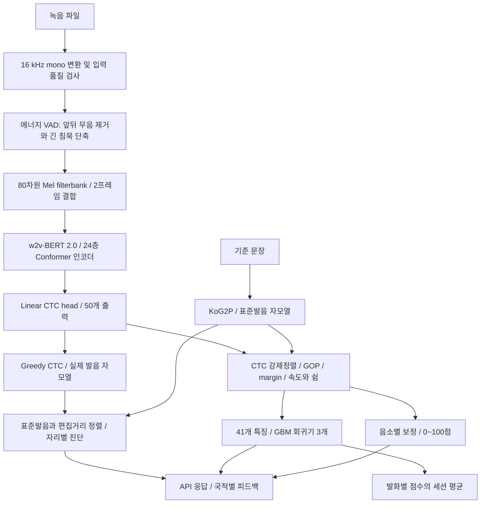

# 발음평가 모델·학습·API 구성

> **9월 27일 구성의 보존 기록이다.** 본문의 “현재”와 CUDA 실행은 당시 확인 상태다. 10월 21일 이후 M3 NPU 운영 구성과 마지막 확인일(10월 25일)은 [현재 서비스 모델](발음평가_현재_서비스_모델.md)을 따른다. 문서 안내 갱신: 2026-10-29.

작성 기준: 2026-09-27. 대상 저장소: `/home/btdevgpu02/project/speech-ai-project`.

이 문서는 현재 실행 중인 통합 발음평가 서버의 실행 인자, 체크포인트 설정, 학습 스크립트·로그, 평가 산출물, API 소스를 확인해 작성했다. 서비스는 재시작하거나 변경하지 않았다. HTTP로는 `/health`만 조회했으며, 아래 요청 예시는 이번 조사에서 실제 채점한 응답이 아니다.

## 1. 현재 구성 요약

현재 통합 서버는 **w2v-BERT 2.0 기반 한국어 자모 CTC 모델**로 실제 발음을 인식한다. 읽을 문장에서 생성한 표준발음과 인식 결과를 정렬해 오류를 진단하고, 같은 모델의 출력 확률에서 특징을 추출해 발음·이해가능성·유창성 점수를 계산한다.

| 구성 | 현재 확인된 값 |
|---|---|
| 서버 진입점 | `deploy/pronunciation-demo/app.py` |
| HTTP 프레임워크 | FastAPI + Uvicorn |
| 실행 주소 | `0.0.0.0:8932` — 프로그램 기본 주소는 `127.0.0.1:8932` |
| 실행 장치 | `/health`에서 `device=cuda` 확인 |
| 음성 모델 | `Wav2Vec2BertForCTC`, 약 581M 파라미터 |
| 사전학습 출발점 | `facebook/w2v-bert-2.0` |
| 현재 체크포인트 | `/data/speech-ai/corpus/checkpoints/w2vbert_stage2/step_38000` |
| 점수 회귀기 | `/data/speech-ai/out/mdd/score_v2_w2vbert/score_models_v2_w2vbert.joblib` |
| 음소 분포·보정 자산 | `/data/speech-ai/out/mdd/score_phoneme/` |
| 입력 | 녹음 파일 + 기준 문장. `/speak`는 문장 없는 전사도 지원 |
| 주요 API | `POST /speak`, `POST /sent.eval.kr` |
| 세션 저장 | 서버 프로세스 메모리의 `SESS` |
| 녹음 저장 | 현재 `--save-dir /data/speech-ai/out/mdd/webmic_takes` 설정 |

루트 README에 있는 **XLS-R 300m / `mdd_tag_all_native.pt`**는 이전 서비스 계열이다. 그 설명과 현재 8932 서버의 모델·성능·API를 섞으면 안 된다. 기존 API는 별도로 `deploy/mdd-api/mdd_infer_api.py`에 남아 있다.

## 2. 아키텍처



### 2.1 음성 인코더와 CTC 출력

실제 `step_38000/config.json`과 `preprocessor_config.json`에서 확인한 값이다.

| 항목 | 값 |
|---|---|
| 입력 샘플레이트 | 16,000 Hz |
| 특징 추출기 | `SeamlessM4TFeatureExtractor` |
| Mel filterbank | 80차원, stride 2로 결합하여 입력 160차원 |
| 출력 시간 간격 | 코드 기준 약 20 ms, 50 Hz |
| 인코더 층 수 | 24 |
| hidden size / FFN | 1,024 / 4,096 |
| attention heads | 16 |
| Conformer depthwise convolution kernel | 31 |
| 위치 표현 | `relative_key` |
| adapter | `add_adapter=false` |
| CTC vocabulary | 50 = 자모 사전 46종 + 특수 토큰 자리 4개 |
| blank index | 0 |
| 디코딩 | 프레임 argmax → 연속 중복 제거 → blank 제거. 별도 언어모델 없음 |
| 추론 정밀도 | CUDA 사용 시 FP16, CPU 경로는 FP32 |

문장의 표준발음을 그대로 출력하게 만드는 ASR이 아니라, 학습자가 틀리게 발음한 내용도 보존하는 것이 목표다. 기준 문장은 음성 인코더에 텍스트 입력으로 들어가지 않는다. 모델 출력 이후의 정렬·점수 계산에서 사용한다.

### 2.2 기준 문장과 오류 진단

1. 기준 문장의 공백과 문자를 정리한다.
2. KoG2P로 표준발음 음소열을 만든다.
3. 표준발음 음소열을 자모열로 변환한다. TAG 관례에 맞춰 `ㅙ→ㅗ+ㅐ`, `ㅞ→ㅜ+ㅔ`를 적용한다.
4. 인식 자모열과 표준 자모열을 `edlib` 편집거리 정렬로 비교한다.
5. 자리별 일치·대치·삭제 및 삽입을 기록한다. 표시에 필요한 KoG2P 음소 기호도 붙인다.

진단의 '표준발음'과 모델 학습의 '정답 실제 발음'은 다르다. 외국인 음성 학습에는 실제 발음 TAG를 쓰고, 진단할 때만 기준 문장에서 만든 표준발음과 비교한다.

### 2.3 같은 forward에서 점수 재료 추출

`gop_feats_v2.py`의 `forward_lprobs()`와 `utt_features()`를 공유한다. 진단용 모델과 점수용 대형 음성 모델을 따로 실행하는 구조가 아니다.

- CTC Viterbi 강제정렬로 기준 음소의 시간 구간을 구한다.
- GOP 평균·분위수·최솟값·분산, CTC NLL, 표준발음 대비 편집거리 등을 계산한다.
- 발화 길이, 발화속도, 조음속도, 쉼 횟수·길이·비율을 계산한다.
- 대치·삭제·삽입 비율, 초성·받침·모음 오류 비율 등 정렬 특징을 추가한다.
- 이 41개 특징을 점수 회귀기에 입력한다. 실제 특징 순서는 joblib의 `feature_names`를 따른다.

CTC blank 자체를 무음으로 보지 않는다. 쉼 특징은 강제정렬된 음소 구간 사이 간격을 이용하며, 기준 임계값은 0.25초다.

음소별 `margin GOP`는 해당 구간에서 **목표 음소 로그확률 − 목표를 제외한 최대 로그확률**의 평균이다. 기존 max-normalized GOP가 정답을 1등으로 인식하면 0으로 몰리던 문제를 줄이기 위해 추가했다.

## 3. 어떻게 학습했는가

### 3.1 데이터와 라벨

| 데이터 | 용도 | CTC 타깃 |
|---|---|---|
| KsponSpeech 원어민 음성 | Stage 1 한국어 적응, Stage 2 replay | 발음 전사 → KoG2P → 자모 |
| AIHub 040·041·042·043 외국인 발음 음성 | Stage 2 오발음 적응 | 전문가의 실제 발음 TAG → 자모 |
| 사람의 발음숙달·이해가능·유창성 점수 | 별도 회귀기 학습 | 1~5점 라벨 |

외국인 CTC 타깃을 표준발음이나 맞춤법 전사로 대체하지 않는다. 그러면 실제 오발음을 표준발음으로 고쳐 출력하는 방향으로 학습될 수 있다. LAB/표준발음은 오발음 유무 분류와 평가에 사용한다.

### 3.2 Stage 1 — 원어민 한국어 CTC 적응

- 출발 모델: `facebook/w2v-bert-2.0`.
- 데이터: KsponSpeech 531,162발화, 약 691시간.
- 매니페스트: `manifest_kspon_native_v1`.
- 학습 완료: 10,000 optimizer steps.
- 결과: `w2vbert_stage1/step_10000`.
- 로그 마지막 검증 UER: 6.421%.
- 로그 wall time: 23,884초, 약 6.63시간. 전체 환경에서 항상 같은 시간이 걸린다는 의미는 아니다.

학습 스크립트의 기본 레시피는 peak LR `3e-5`, 처음 2,000스텝 인코더 동결 후 전체 미세조정이다. LR과 완료 스텝은 로그와 일치한다. 최초 실행 명령 전체는 이번 조사에서 확보하지 못했으므로, 기본 옵션 모두를 실제 실행 인자로 확정하지는 않는다.

### 3.3 Stage 2 — 외국인 실제 발음 적응

실제 실행 파이프라인은 `/data/speech-ai/out/mdd/experiments/pipeline_w2vbert.sh`다.

- Stage 1의 `step_10000`에서 시작한다.
- `manifest_full_tag_replay10`을 사용한다.
- 외국인 데이터 내부의 정상:오발음 발화 비율을 **60:40**으로 맞춘다.
- 전체 학습 행 중 **10%**를 원어민 replay로 넣는다.
- 정상 외국인 발화는 모두 쓰고 오발음 발화를 복제·추가 표집한다.
- 비율은 **발화 수 기준**이다. 10% 원어민을 시간 비율 10%라고 설명하면 틀린다.

실제 `stats.json`의 구성:

| Stage 2 학습 구성 | 학습 행 수 | 전체 행 비율 | 시간 |
|---|---:|---:|---:|
| 정상 외국인 | 1,080,172 | 54% | 920.9 h |
| 오발음 외국인, 재표집 포함 | 720,115 | 36% | 763.1 h |
| 원어민 replay | 200,032 | 10% | 269.6 h |
| 합계 | **2,000,319** | 100% | **1,953.6 h** |

위 시간과 행 수에는 복제된 오발음 데이터가 포함된다. 고유 외국인 학습 풀은 1,481,511발화, 9,656화자, 226문항이다. 원어민 replay의 실제 시간 비율은 13.8%다.

품질 필터는 0.5~15초, 원본 8 kHz 제외, 빈 라벨·누락 음소 tier·사전 밖 자모 제외다. 제외 20,547건 중 길이 16,834건, 8 kHz 3,314건, 나머지 라벨 관련 399건이다.

| 분할 | 발화 | 화자 |
|---|---:|---:|
| valid | 10,000 | 1,218 |
| test | 184,074 | 1,195 |

외국인 train/valid/test 사이 화자 교집합은 모두 0이다. 반면 valid/test 문항은 모두 train에도 있다. 따라서 성능 조건은 **본 문항·안 본 화자**다. `test_unseen`이라는 기존 파일 이름만 보고 '처음 보는 문장 성능'이라고 설명하면 안 된다.

### 3.4 최적화 설정과 실제 선택 모델

| 설정 | 값 / 근거 |
|---|---|
| loss | CTC, mean reduction, `zero_infinity=true` |
| optimizer | AdamW, betas `(0.9, 0.98)`, eps `1e-8`, weight decay 0 |
| batch budget | 기본 1,600,000 audio samples, 배치 최대 64발화 |
| gradient accumulation | 기본 4 microbatches |
| gradient clipping | norm 5.0 |
| precision | AMP FP16 + GradScaler |
| LR schedule | tri-stage: 10% warmup / 40% 유지 / 50% 지수 감소 |
| 최종 LR 비율 | peak의 0.05 |
| Stage 2 peak LR | `1e-5` — 실행 스크립트 확인 |
| Stage 2 동결 | `--freeze-updates 0` |
| Stage 2 학습량 | 40,000 steps — 로그 확인 |
| 저장·검증 간격 | 2,000 steps, valid 10,000건 |
| 선택된 배포 스텝 | **38,000** |
| Stage 2 로그 wall time | 62,188초, 약 17.27시간 |

학습 코드는 `mask_time_prob=0.5`, `mask_feature_prob=0.5`, `mask_feature_length=64`를 설정한다. **그러나 Stage 1과 Stage 2의 실제 저장 config는 `apply_spec_augment=false`다.** 따라서 '마스킹 증강을 켜고 학습했다'고 단정하지 않는다. 레시피 주석과 저장 설정이 다른 부분이다. 설정상 layerdrop와 activation dropout은 각각 0.1이다.

체크포인트는 test 최고점으로 고르지 않았다. valid에서 다음 키를 순서대로 비교했다.

1. 정상 자리 오류율이 낮은 것.
2. JER이 낮은 것.
3. 오발음 보존율이 높은 것.
4. 표준발음 되돌림률이 낮은 것.
5. 소수 네 자리까지 동률이면 이른 스텝.

`final_selection.json`에서 38,000스텝을 선택한 기록이 확인된다. 학습 스크립트의 `best.json`은 UER 최저 기준이므로 제품 선택 규칙과 구분해야 한다.

### 3.5 점수 회귀기 학습

음성 CTC 모델을 고정한 다음, 특징 41종으로 `HistGradientBoostingRegressor` 세 개를 학습한다.

| 항목 | 값 |
|---|---|
| 목표 | `pron`: 발음숙달, `comp`: 이해가능성, `flu`: 유창성 |
| 학습 단위 | 발화별 특징 → 사람의 1~5점 |
| 유효 라벨 | 해당 차원의 점수가 존재하고 0보다 큰 발화 |
| max_iter / learning_rate | 400 / 0.06 |
| max_depth / min_samples_leaf | 4 / 200 |
| L2 / random_state | 1.0 / 0 |
| 데이터 분리 | 파일명 앞 5자리 화자 ID로 train/test 교집합 assert |
| 배포 | 모델 3개 + `feature_names` + metrics를 joblib로 저장 |

서비스의 세션 점수는 각 발화의 예측값을 평균한다. 특징을 먼저 평균해서 회귀기에 한 번 넣는 방식이 아니다. CTC 모델을 교체하면 특징 분포가 달라지므로 해당 모델로 추출한 특징의 회귀기를 함께 써야 한다.

유창성 라벨이 없는 발화를 0점으로 채우지 않는다. 2026-09-26 정정 기록에서 유창성 유효 라벨 42,044건의 발화 단위 PCC는 0.610으로 확인됐다. 이전의 음수 상관 설명은 결측 라벨 처리 오류였다.

## 4. 성능과 적용 범위

현재 w2v-BERT 체크포인트의 저장된 평가 결과다. 이번 문서 작업에서 재학습·재평가하지 않았다.

| 지표 | 본 문항·안 본 화자 184,074발화 | 같은 조건의 30문항 부분집합 23,562발화 |
|---|---:|---:|
| JER | 4.71% | 4.65% |
| MDD precision | 0.4768 | 0.4820 |
| MDD recall | 0.5177 | 0.5042 |
| MDD F1 | **0.4964** | **0.4928** |
| 오발음 보존율 | 43.98% | 43.23% |
| 표준발음 되돌림률 | 48.23% | 49.58% |
| 정상 자리 오류율 | 2.26% | 2.21% |
| 정상 포함 legacy weighted F1 | 0.9562 | 0.9562 |

**weighted F1 0.9562를 '발음 오류를 95.62% 찾아낸다'로 해석하면 안 된다.** 정상 위치가 많은 지표이고, 오류 진단 능력은 MDD precision/recall/F1과 함께 봐야 한다. 서로 다른 채점 함수의 `legacy.err_f1`과 `mdd.f1`도 구분한다.

w2v-BERT 회귀기의 기존 동일 조건 비교 보고값은 화자 단위 PCC 발음 0.6707 / 이해 0.6868 / 유창성 0.7620이다. 다른 데이터·집계 조건에서 나온 수치와 섞지 않는다. 새 문장에 대한 완전한 문항 홀드아웃 성능은 현재 모델에 대해 확인되지 않았다.

## 5. API 내부 처리

### 5.1 입력과 전처리

- 16 kHz / mono / PCM16 WAV는 메모리에서 직접 읽는다.
- 다른 포맷은 ffmpeg stdin/stdout으로 16 kHz mono float32로 변환한다.
- 0.3초 미만 녹음은 HTTP 400이다.
- `/speak`는 RMS `<1.5e-3`도 거절한다.
- 최대 앞 20초를 분석한다. 전체 파일을 읽은 뒤 자르는 구현이며 업로드 크기 제한과는 다르다.
- 에너지 VAD에서 말소리 1.0초 미만 또는 비율 30% 미만이면 `low_speech`로 거절한다.
- VAD는 30 ms 프레임, 임계 `max(최대 RMS×0.06, 8e-4)`다.
- 앞뒤 무음은 0.15초 여유를 두고 자르고, 내부 긴 무음은 약 0.5초까지만 남긴다.

따라서 유창성 특징은 이 전처리 이후 파형에서 계산된다. 원본 녹음의 긴 침묵을 그대로 측정한 값은 아니다. 짧은 인사말도 말소리 1초 조건에 걸릴 수 있다.

### 5.2 엔드포인트

| Method | 경로 | 입력 | 역할 |
|---|---|---|---|
| GET | `/health` | 없음 | `ok`, `device`, 세션 수 |
| GET | `/sentences` | 없음 | 연습 문장 목록 |
| GET | `/countries` | 없음 | L1 피드백에서 지원하는 국적 목록 |
| POST | `/speak` | multipart: `audio`, `sentence`, `country`, `id`, `token` | 진단 + 발화 점수 + 세션 누적 |
| POST | `/sent.eval.kr` | multipart: `audio`, `refText`, `tokenId`, `userId` 등 | SpeechSuper 형식을 참고한 문장·글자·음소 응답 |
| GET | `/session?id=...` | query `id`, 기본 `default` | 세션 요약과 발화 이력 |
| POST | `/reset` | form `id`, 기본 `default` | 해당 세션 삭제 |

`audio`는 `/speak`의 필수 파일이다. `sentence`와 `country` 기본값은 빈 문자열이다. `/sent.eval.kr`는 빈 `refText`를 거절한다. 이 API는 `audio`라는 이름이 없으면 첫 업로드 파일을 사용할 수 있다.

### 5.3 `/speak` 요청과 응답 필드

```bash
curl -sS http://127.0.0.1:8932/speak \
  -F 'audio=@sample.wav' \
  -F 'sentence=저는 한국어를 공부하고 있어요' \
  -F 'id=learner-001'
```

| 응답 필드 | 의미 |
|---|---|
| `canon_jamo`, `canon_phone` | 기준 문장의 표준발음 |
| `pred_jamo`, `pred_phone` | 모델이 들은 실제 발음 |
| `sites` | 자리별 `i`, `canon`, `pred`, `verdict`, 음소 표기·삽입 정보 |
| `feedback` | 선택한 국적에 따른 오류 경향·교정 정보, 없으면 null |
| `scores` | 발화별 회귀 점수 `pron/comp/flu`, 1~5점; 사용 불가 시 null |
| `summary` | 세션 발화 수, 충분성, 평균 점수, 음소별 점수와 약점 |
| `vad` | 무음 제거와 말소리 정보 |
| `sec`, `rms`, `ms` | 원본 길이, 입력 RMS, 처리 시간 |

`country`는 국적 분류 모델을 이 API가 자동 실행한다는 의미가 아니다. 사용자가 선택한 국적을 L1 피드백 조회에 사용한다.

### 5.4 세션 집계

현재 `SessionScorer`는 다음 정책을 사용한다.

- 점수가 있는 발화 10개 이상이면 `summary.enough=true`.
- 권장 누적은 30발화다.
- **10개 미만에도 `summary.scores`에는 평균이 들어갈 수 있다.** 클라이언트가 `enough`를 확인해야 한다. 서버가 항상 null로 숨겨준다고 설명하면 틀린다.
- 음소 그룹은 초성/받침/모음 × 자모로 나누며, 해당 그룹의 관측 자리 20개 이상부터 점수를 낸다.
- `norms.json` 분포에 평균 margin을 대입해 0~100 백분위로 변환하고 낮은 다섯 그룹을 `weak`에 담는다.
- `id`를 생략하면 `default` 세션에 쌓인다. 사용자별 고유 ID를 보내야 한다.
- 세션은 프로세스 메모리이므로 재시작하면 사라진다. 프로세스를 늘려도 자동 공유되지 않는다.

`/sent.eval.kr`는 세션에 발화를 추가하지 않는다. 그 요청의 `userId`는 현재 `_meta`에 기록되는 값이다.

### 5.5 `/sent.eval.kr` 요청

간편 multipart 형식:

```bash
curl -sS http://127.0.0.1:8932/sent.eval.kr \
  -F 'audio=@sample.wav' \
  -F 'refText=저는 한국어를 공부하고 있어요' \
  -F 'tokenId=record-001' \
  -F 'userId=learner-001'
```

`tokenId`는 인증 토큰이 아니라 응답 `recordId`로 돌려주는 요청 식별자다.

다른 지원 형식은 multipart 문자열 필드에 JSON을 넣는 방식이다. 코드가 문자열 필드를 순회해 `start.param.request`, `param.request`, `request`를 찾고 `refText/tokenId`를 읽는다. `start.param.app.userId`도 지원한다. 외부 SpeechSuper로 중계하는 API가 아니라 자체 모델로 처리하는 API다.

```json
{
  "start": {
    "param": {
      "app": {"userId": "learner-001"},
      "request": {
        "refText": "저는 한국어를 공부하고 있어요",
        "tokenId": "record-001"
      }
    }
  }
}
```

주요 응답 구조는 다음과 같다. 아래는 필드 설명용이며 실제 측정 응답이 아니다.

```text
refText
recordId
result
  overall, pronunciation, fluency
  rhythm, comprehensibility
  words[]
    word, readType, score
    phonemes[]
      alpha, alpha_jamo, position
      pronunciation, actual, actual_jamo
      errorType?, uncertain?
    inserted[]?
_meta
  engine, scale, score source/해석 정보, ms, audio, userId, request_style
```

`words[]`는 구현상 띄어쓰기 단어가 아니라 한글 글자 단위로 묶인다. `alpha`는 KoG2P 기호, `alpha_jamo`는 한글 자모다. 외부 SpeechSuper와 필드명·음소 체계·점수 의미가 완전히 같지는 않으므로 주소만 바꾸는 완전 호환으로 설명하지 않는다.

`readType`: 0 정상, 1 전체 음소 미인식/누락, 2 대치·삭제, 3 낮은 점수의 오독, 4 삽입. 이 값은 모델의 별도 분류 헤드 출력이 아니라 정렬과 점수로 만든 후처리 결과다.

### 5.6 0~100점 산식과 null 정책

`/speak`의 1~5점 회귀 출력과 `/sent.eval.kr` 점수는 별도 의미다.

- 음소 점수: `calibration.json`이 있으면 `(1 − 보정된 오류 확률) × 100`. 없으면 `norms.json` 백분위 사용.
- 글자 점수: 채점 가능한 음소 점수의 평균. 오독 정책에 따라 내부 0점이 될 수 있다.
- 문장 `pronunciation`: 채점 가능한 글자 점수의 평균.
- `fluency`: 기본 회귀 예측을 백분위 또는 5점 대비 비율로 환산하되, **`fluency_rule.json`과 특징이 있으면 속도·쉼 규칙 점수가 우선**한다. 현재 파일은 존재한다.
- `comprehensibility`: `--utt-comp`를 켜야 단일 발화 값을 노출한다. 현재 실행 인자에는 없으므로 기본 null이다.
- `rhythm`: 실제 리듬 모델이 아니라 `comprehensibility`와 같은 값이다. 현재 기본 설정에서는 역시 null이다.
- `overall`: 발음 0.6 / 유창 0.2 / 이해 0.2 가중평균. 없는 차원은 빼고 남은 가중치를 정규화한다. 이해도 미노출 상태에서 발음·유창성이 모두 있으면 실질 비중은 75:25다.

0점과 판독 불가 null은 내부 계산에서는 구분하지만, 현재 응답 정책은 최종 0점을 null로 바꾼다. 평균은 0을 포함해 먼저 계산하고 마지막에 바꾼다. 따라서 **응답 null만으로 실제 0점인지 판정 불가인지 구별할 수 없다.** 소리를 대응시키지 못한 음소는 `actual_jamo=null`, 해당 음소 점수도 null이다.

정렬상 대치라도 음소 점수 60 이상이면 사용자에게 보여줄 `errorType`을 제거하고 `uncertain=true`를 붙인다. 실제 인식값은 보존한다. 이것은 학습 가중치 변경이 아닌 표시 정책이다.

### 5.7 인증과 실행 특성

`--token` 또는 `MDD_API_TOKEN`이 설정되면 `/speak`와 `/sent.eval.kr`는 인증을 검사한다. `Authorization: Bearer ...`, `X-API-Key`, query `token`, form `token`을 지원한다. 토큰 값 자체는 이 문서에 포함하지 않는다.

현재 코드에서 `/session`, `/reset`, `/health` 등에 같은 인증 검사가 적용되어 있지는 않다. 또한 HTML 응답에 토큰을 주입하는 데모용 경로가 있다. 이는 사용자별 인증·인가를 갖춘 운영 API와 구분해야 하는 현재 구현 특성이다.

`/speak`와 `/sent.eval.kr`는 async 핸들러 안에서 동기 추론을 직접 호출한다. 전용 추론 큐·배치 워커·공유 세션 저장소는 없다. 현재 코드가 요청을 GPU에서 자동 병렬 처리한다고 가정하면 안 된다.

## 6. 실행과 재현

### 6.1 현재 계열 API 실행 예시

저장소 루트에서 실행한다. 포트는 기존 서버와 겹치지 않는 것을 사용한다.

```bash
source tools/env.sh
export PYTHONPATH=/data/speech-ai/tools/hf_py38${PYTHONPATH:+:$PYTHONPATH}

"$PY" deploy/pronunciation-demo/app.py \
  --hf-ckpt "$SPEECH_AI_DATA/checkpoints/w2vbert_stage2/step_38000" \
  --scorer "$MDD_OUTPUTS/score_v2_w2vbert/score_models_v2_w2vbert.joblib" \
  --norms "$MDD_OUTPUTS/score_phoneme/norms.json" \
  --host 127.0.0.1 --port 8933
```

학습·추론용 HF 의존성을 기존 fairseq 환경과 분리해 별도 경로로 얹는 구성이므로 `tools/env.sh`와 HF 패키지 경로를 함께 확인해야 한다. 현재 체크포인트에는 `transformers_version=4.46.3`이 기록돼 있다. 사전·특징 추출기·회귀기·보정표도 모델과 함께 관리해야 한다.

### 6.2 Stage 2 학습 명령

실제 파이프라인에서 확인한 인자다. 아래는 새 실험 경로를 사용한 재현용 예시이며 현재 체크포인트를 덮어쓰지 않는다.

```bash
T=tasks/pronunciation-assessment
"$PY" "$T/scripts/train/train_w2vbert_ctc.py" \
  --manifest "$MDD_OUTPUTS/manifest_full_tag_replay10" \
  --valid-split valid \
  --model "$SPEECH_AI_DATA/checkpoints/w2vbert_stage1/step_10000" \
  --save-dir "$SPEECH_AI_DATA/checkpoints/w2vbert_stage2_new" \
  --max-update 40000 --lr 1e-5 --freeze-updates 0 \
  --save-interval 2000 --valid-n 10000
```

학습은 40,000까지 수행하고 valid 평가로 배포 후보를 고른다. 지금과 같은 스텝이 선택될 것을 보장하지 않는다. 저장 config의 증강 플래그 차이도 재현 전에 확인해야 한다.

## 7. 기존 XLS-R API와의 차이

| 항목 | 현재 통합 서버 | 기존 API |
|---|---|---|
| 파일 | `deploy/pronunciation-demo/app.py` | `deploy/mdd-api/mdd_infer_api.py` |
| 모델 | w2v-BERT `step_38000` | XLS-R 300m `mdd_tag_all_native` |
| 로딩 | HF checkpoint 디렉터리 | fairseq PT 또는 ONNX |
| 주요 경로 | `/speak`, `/sent.eval.kr` | `/diagnose` |
| 세션 식별자 | form `id` | form `session_id` |
| 세션 조회/삭제 | GET `/session?id=...`, POST `/reset` | GET/DELETE `/session/{sid}` |
| 세션 충분성 | 10발화, 권장 30; 평균 자체는 이전에도 반환 가능 | 5발화 미만 `pending`, scores=null |
| 음소 표시 | 자리별 판정 + margin 점수 + 글자 매핑 | errors / not_recognized + per_phone GOP |
| CPU 경량화 | 현재 주 경로는 HF | XLS-R ONNX int8 지원 |

기존 ONNX int8 파일 크기·지연·처리량 측정치를 현재 w2v-BERT 서버의 실측 성능으로 인용하지 않는다. 이전 계열 학습은 XLS-R 사전학습 → TAG 전체 50k → LAR 적응 15k → 원어민 혼합 이어학습이며, native 설정의 60k는 상한이지 확인된 최종 완료 스텝이 아니다.

## 8. 근거 파일

상대 링크는 이 문서 위치를 기준으로 한다.

| 근거 | 확인 내용 |
|---|---|
| [통합 API](../deploy/pronunciation-demo/app.py) | 실제 요청·응답, 입력 검사, 모델 로딩, 실행 옵션 |
| [학습 코드](../tasks/pronunciation-assessment/scripts/train/train_w2vbert_ctc.py) | CTC, optimizer, freeze, LR, 저장·검증 |
| [Stage 2 데이터 구성](../tasks/pronunciation-assessment/scripts/data/build_full_tag_replay.py) | 라벨, 재표집 비율, 화자 분리 |
| [공통 특징 계산](../tasks/pronunciation-assessment/src/mdd/gop_feats_v2.py) | HFDecoder, 강제정렬, 41개 특징, margin |
| [점수 회귀기 학습](../tasks/pronunciation-assessment/scripts/score/train_score_models.py) | GBM 설정, 라벨 필터, 화자 교집합 검사 |
| [세션 집계](../tasks/pronunciation-assessment/src/mdd/session.py) | 10/30발화 정책, 음소 그룹 관측 20개 |
| [문장·음소 응답 포맷](../tasks/pronunciation-assessment/src/mdd/speechsuper.py) | 가중평균, readType, 점수·null 정책 |
| [VAD](../tasks/pronunciation-assessment/src/mdd/vad.py) | 음성 구간 검출과 무음 단축 |
| [2026-09 진행 현황](../tasks/pronunciation-assessment/results/15_진행현황_2026-09.md) | 데이터·모델 비교 및 문항 겹침 정정 |
| [외부 API 비교와 후속 정정](../tasks/pronunciation-assessment/results/16_SpeechSuper_API_비교_2026-09-25.md) | 유창성 라벨 결측·매핑·null 정책 해석 |
| [기존 API](../deploy/mdd-api/mdd_infer_api.py) | 구형 `/diagnose` 인터페이스 |

저장소 밖에서 확인한 원본:

- `/data/speech-ai/corpus/checkpoints/w2vbert_stage{1,2}/train.log`
- `/data/speech-ai/corpus/checkpoints/w2vbert_stage2/step_38000/{config.json,preprocessor_config.json,jamo_vocab.json}`
- `/data/speech-ai/out/mdd/manifest_full_tag_replay10/stats.json`
- `/data/speech-ai/out/mdd/experiments/pipeline_w2vbert.sh`
- `/data/speech-ai/out/mdd/experiments/w2vbert/final_selection.json`
- `/data/speech-ai/out/mdd/experiments/w2vbert/w2vbert_test.metrics.json`
- `/data/speech-ai/out/mdd/experiments/w2vbert/w2vbert_fcv2_test_unseen.metrics.json`

프로세스 실행 인자는 현재 선택된 체크포인트와 옵션을 확인하는 데 사용했다. 소스 파일이 실행 이후 바뀌었을 가능성까지 이번 조사에서 배제한 것은 아니므로, 상세 응답 동작은 현재 디스크의 소스 기준이다.
